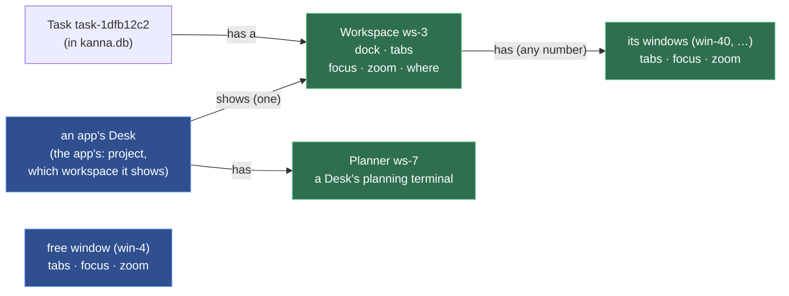
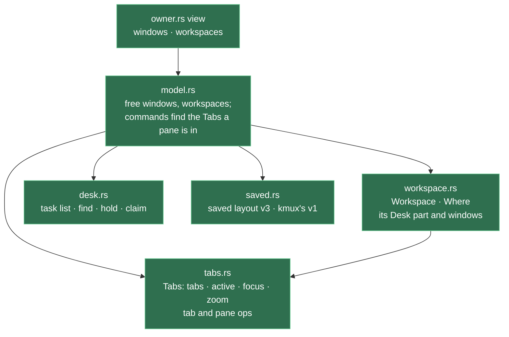

# Workspaces

**Status:** built; Desks are each app's since [each app's Desks](app-desk.md) · **Builds on:** [layout](layout.md), [Desk](desk.md), [tasks](tasks.md), [presenting](presenting.md)

A task is a unit of work. Its **workspace** is how it's presented: its agent docked beside its tabs, with the shown tab, focus and zoom, plus any windows of its own. The daemon keeps every workspace and where it is: on an app's Desk (that app's claim) or on the Shelf. Which Desk shows which workspace, and which is active, is each app's ([each app's Desks](app-desk.md)). A command from a task's pane goes to its own workspace, wherever it's shown, and the reply names the task and where it is.

## Contents

1. [The model](#1-the-model)
2. [What moves a workspace](#2-what-moves-a-workspace)
3. [Commands: target and reply](#3-commands-target-and-reply)
4. [Kinds of window, and the planning terminal](#4-kinds-of-window-and-the-planning-terminal)
5. [Saved state](#5-saved-state)
6. [Code and tests](#6-code-and-tests)
7. [The branches waiting for review](#7-the-branches-waiting-for-review)
8. [Backport to kmux](#8-backport-to-kmux)
9. [Decisions](#9-decisions)
10. [Glossary](#10-glossary)

## 1. The model



- **A workspace has an ID of its own,** `ws-1`, `ws-2`, …, made by the layout, which knows nothing of tasks. **A task has a workspace:** the daemon's record of the task names it ([workspace list](workspace-list.md#a-task-has-a-workspace)). It keeps it from start to Done, wherever it goes. A workspace whose agent was docked by hand is a task's workspace too, with no Shelf task.
- **A planner is a workspace with no task:** a Desk's planning terminal docked, with no tabs. A pane opened from it or into it gets a new free window.
- **A workspace has a Desk part and windows of its own.** The Desk part (the docked agent and its tabs) is what an app's Desk shows. Its own windows are ordinary windows with their own IDs; each app keeps their frames ([windows](windows.md#2-what-the-app-keeps)).
- **A window isn't a workspace.** In the daemon it's one of a workspace's windows, or free (in no workspace); a Desk is the app's.
- **`where`** is one of: on an app's Desk (`{"shelf": "mac"}`), on the Shelf (`"backlog"`), or a Desk's planner (`{"planner": "mac"}`). The values keep their names from before the [Desk view rename](desk-view.md#5-internal-names).
- **What shows is each app's.** An app shows a workspace, its windows included, while one of its Desks shows it as the active task; the rest of its claims are on its Desk, not shown. Hidden or not, panes keep running, the Desk part at the Desk's size ([pane sizes](pane-sizes.md)) and each window at the size it last had.

Green: workspaces and their windows. Blue: the app's Desks and free windows. A Shelf task gets a workspace when it first starts; until then it's only a name and a first message ([tasks](tasks.md#3-the-shelf)).

## 2. What moves a workspace

Each one changes `where`, an app's Desk, or which workspace a window or pane is in. None copies tabs, focus or zoom.

| Action | Workspace | In the app |
|---|---|---|
| `kanna task start` (on the Shelf) | new `ws-N`, docked agent, on the Shelf; the task records it | — |
| Move to Desk (`pick`) | new, or the held one, claimed by the app (`{"shelf": app}`) | at the front of that app's Desk's tasks |
| `activate` on a Desk | unchanged | the Desk shows it and its windows open where the app last had them; the one active before stays on the Desk and its windows close |
| `park` (⌘.) | unchanged | the Desk shows the Desk view, the task still active; the workspace's windows close |
| Move to Shelf (`shelve`, `hold`) | → the Shelf, as it is | off the app's Desk |
| `stop` | unchanged | unchanged |
| `done` | closed with its panes and its windows | the Desk shows the Desk view, no task active |
| Its agent's pane closes | gone: its tabs leave for a new free window, its windows become free | — |
| `open --window new`, or a tab torn off, from the workspace | a new window of the workspace | on screen if the workspace is |
| A tab torn off a free window | — | a new free window |
| `move PANE --window W`, a tab dragged to W | the pane or tab joins W's workspace, or W if it's free | — |
| `kanna window assign W task-1dfb` | W becomes one of task-1dfb's windows | W shows while task-1dfb is on a Desk |
| `kanna window free W` | W leaves its workspace | W shows |

A pane belongs to the workspace it's in. Moving it to another workspace's window moves it to another task, so that's always a deliberate drag or `move`, never a side effect of where a task happens to be shown.

## 3. Commands: target and reply

**The caller** is the CLI's `$KANNA_TERMINAL`. A command that names a pane or tab acts where *that* pane or tab is. One that names nothing acts where the caller is: its workspace's Desk part, one of its windows, or a free window. With no caller (run outside a Kanna terminal, or from a terminal this Kanna doesn't know), it's refused with the flag to give, never sent to the key window ([the CLI acts on its caller](cli-caller.md)). `--window W` aims at W, whoever's it is; a task's pane may do that, though it rarely needs to, and the reply names W's workspace so the agent sees where its pane went.

| Command | From a task's pane (task-1dfb) | From a pane in a free window (win-4) |
|---|---|---|
| `open` | beside the caller: as asked when on screen; a new tab when hidden | into win-4, as kmux |
| `open --window new` | a new window of task-1dfb | a new free window |
| `focus PANE` / `--tab` | that pane's or tab's shown tab and focus; the app brings its window forward only if it's on screen ([physical layout §2](physical-layout.md#2-bringing-a-window-forward)) | the same |
| `focus --window W` | the app brings W forward, if it's on screen | the same |
| `zoom PANE` | that pane's zoom, on screen or not | as kmux |
| `comment` | the markdown pane it opens or finds is beside the caller | in win-4 |
| `arrange` | the caller's shown tab: on screen or not | win-4's shown tab |
| `screenshot` | the caller's window, if it's showing | win-4 |
| `move PANE --window W` | into W | as kmux |
| `window assign W TASK\|WORKSPACE` / `window free W` | puts W in that workspace, or frees it ([4](#4-kinds-of-window-and-the-planning-terminal)) | the same |
| `close` | a pane, a tab, or `--window W` (and its panes) | as kmux |
| `workspace list` | its workspace: dock, tabs, panes, shown tab, focus and zoom, and its windows ([workspace list](workspace-list.md)) | win-4 |

Replies say which workspace and where it is. A window is named when the pane is in one:

| Case | Reply |
|---|---|
| open, ws-3 on the Desk | `opened term-5 in ws-3 (task-1dfb, on the Desk), tab-9: running` |
| open, ws-3 on the Shelf | `opened term-5 in ws-3 (task-1dfb, on the Shelf), tab-9: running` |
| open in ws-3's win-40 | `opened term-5 in ws-3's win-40 (task-1dfb, on the Desk), tab-9: running` |
| open in a free window | `opened term-5 in win-4, tab-9: running` |
| focus, in no window | `focused spec in ws-3 (task-1dfb, on the Shelf)` |
| focus, in ws-3's win-40 | `focused spec in ws-3's win-40 (task-1dfb, on the Desk, in front)` |
| zoom, in no window | `spec is zoomed in ws-3 (task-1dfb, on the Desk; run again to unzoom)` |
| assign | `assigned win-41 to ws-3 (task-1dfb, on the Desk)` |
| free | `win-41 is free (out of ws-3)` |

Layout replies carry `workspace: {id, where}`, or null in a free window, beside `window` and `tab`. `window` is null for a pane in a workspace's Desk part. The daemon adds `task` and `name` to a workspace that's a task's, in every reply. `kanna workspace list --all --json` has `workspaces`, each with its dock, tabs, shown tab, focus, zoom and windows.

## 4. Kinds of window, and the planning terminal

- **A Desk** is the app's ([each app's Desks](app-desk.md)): it shows the Desk view (its planner, its tasks and the Shelf), or its active task's workspace's Desk part. Commands the app sends for a Desk name the workspace it shows (`workspace: ws-N`); a pane opened onto a Desk in the Desk view gets a new window.
- **A workspace's window** belongs to that workspace: its ID stays with it, and an app shows it only while the workspace is on one of its Desks.
- **A free window** belongs to no workspace and shows in every app. It behaves as kmux's window, so kmux's protocol cases pass on it.
- **A window with a lead** (a Quiz window) is free, with its agent docked beside its tabs; it stays its agent's.
- **A window joins or leaves a workspace** when it's made (one made from a task's pane or torn off its tabs is the task's; one made from a free window is free), or with `kanna window assign W TASK|WORKSPACE` and `kanna window free W`, and the Window menu's Assign Window to Task and Free Window ([menus](menus.md)). Both are kmux's `window` command, with a `ws-N` or a pane as the `workspace`; the daemon turns a task's ID into its workspace's before the layout sees it. Refused: a window with a lead (`lead`), a planner (`not_found`: it has no windows), and a task with no workspace yet (`not_started`).
- **The planning terminal never moves.** It's its Desk's, not a task's: `move` and `move --dock` refuse it.

## 5. Saved state

The saved layout (in `kanna.db`, [database](database.md)) is `version: 3`: `windows` holds free windows, and every workspace is in one list with its own windows. The app's Desks are in its `app-state.json` ([each app's Desks](app-desk.md)).

```json
{ "kmux": "state", "version": 3, "counters": { "tab": 12, "window": 41, "workspace": 7 },
  "windows": [
    { "id": "win-4", "tabs": [], "active": "tab-3", "focused": "term-7", "zoomed": null }],
  "workspaces": [
    { "id": "ws-1", "where": { "shelf": "mac" }, "parkedAt": 1792183838,
      "dock": { "pane": "term-12", "edge": "left", "width": 0.4, "frozen": true },
      "tabs": [], "active": "tab-9", "focused": "term-13", "zoomed": null,
      "windows": [{ "id": "win-41", "tabs": [], "active": "tab-12", "focused": "term-20", "zoomed": null }] },
    { "id": "ws-5", "where": "backlog", "dock": {}, "tabs": [], "windows": [] },
    { "id": "ws-7", "where": { "planner": "mac" }, "dock": { "pane": "term-2", "edge": "left", "width": 0.4 }, "tabs": [], "windows": [] }] }
```

- **Older files load.** Version 1's windows with a dock, and version 2's workspaces on a Desk or the old Shelf, become workspaces on `mac`'s Desk (`{"shelf": "mac"}`); a Desk's lead becomes a planner; version 2's task-named workspaces get `ws-N` IDs, their windows following. The app makes its Desks from the planners it hasn't seen. The next save writes version 3.
- **The daemon finds each task's workspace** from the listing it asks for once the app attaches: the workspace whose dock is the task's agent pane. A start records the workspace the reply to its docked, frozen `open` names. Both go in the task's `doc` in `kanna.db` ([database](database.md)).
- **kmux's debug state stays kmux's version 1.** `debug.saveState` writes free windows plainly and each workspace in `parked` with its `where`, so `debug.restoreState` reads it back.
- **`kanna.db`'s `place`** is the task's: `backlog` (the Shelf), `shelf` (on a Desk) or `done` ([database](database.md)).

## 6. Code and tests



- **One `Tabs`** (tabs, shown tab, focus, zoom) is what a free window, a workspace's Desk part and each of its windows hold. Tab and pane ops are written once on it.
- **desk.rs** keeps the task actions: `list` (an app's claims), `find` (a task's agent and workspace), `hold` (to the Shelf) and `claim` (onto an app's Desk).
- **owner.rs** `view` lists every window and every workspace, each with its `where`, dock, tabs and windows; each app composes its Desks from them ([each app's Desks](app-desk.md)).
- **kanna CLI:** `output.rs` writes the replies in [3](#3-commands-target-and-reply); `crates/kanna/tests/cli.rs` checks them.
- **kanna-mux tests:** owner tests check claims, holds, planners, a workspace's tabs, focus and zoom with no window, `window assign` and `free`, and version-1 and version-2 files. `protocol_cases` (kmux's) pass natively and behind `LayoutOwner`, but for kmux's dock cases, since a docked pane is a task's agent in its own workspace.

## 7. The branches waiting for review

- **Quiz window docks its agent** (`quiz-window-docked`) renames `planner` to `lead` and lets a window that isn't a Desk have one (the Quiz window). That fits: a lead is a window's, never a workspace's, so a Quiz window is a free window with a lead. Land it first; this spec says `lead` throughout.
- **Move to a window makes a new tab** (`move-window-new-tab`): `move PANE --window W` makes a new tab at the end of W, which is in W's workspace, or W if it's free. No conflict.

## 8. Backport to kmux

kmux has workspaces without Kanna's Desks, Shelf and tasks, through [the kmux subtree](kmux-subtree.md) (kmux files only, a kmux branch and PR); [kmux's spec, 3.8](../../references/kmux/docs/kmux-spec.md#38-workspaces) has the rules.


- **A kmux workspace** is a named group of windows, shown or hidden, with kmux's own IDs (`ws-1`, apart from `w1`, `t1`, `p1`; a saved `s1` still loads). It has no Desk part: that's Kanna's.
- **Commands:** `workspace new [NAME]`, `workspace hide S`, `workspace show S` (its windows at their frames, its last one key), `workspace close S` (its windows and panes), `window assign W S`, `window free W`, `workspace list [--all]` (the caller's window and its workspace, from `$KMUX_PANE`; `--all` every window and workspace). The app's Window menu has Assign Window to Workspace (the workspaces, and New Workspace) and Free Window, as Kanna's.
- **No caller rules:** kmux has no caller, so `open` still goes to the key window or `--window`, and a new window is free. A hidden window is never the key window, and `focus` on it is refused (`hidden`).
- **Replies** name the workspace as `{id, name, hidden}`: `opened p5 in ws-1's w40 (hidden), tab t9: running`.
- **Saved state:** kmux's state file, still version 1, gains `workspaces` (`id`, `name`, `hidden`) and each window its `workspace`.
- **In Kanna,** a task's workspace is a kmux workspace plus its Desk part, with the same `ws-N` IDs; a Desk task not active and a Shelf task are both hidden to kmux, so its replies say `hidden` too. Kanna's `window` takes kmux's `workspace` (a `ws-N`, a pane, or a task's ID, which the daemon turns into its workspace's) and passes kmux's `window` case; the cases that make workspaces with `workspace` are skipped, since Kanna's `workspace` command has only `list` (tasks do the rest), as the runner skips any case needing a command Kanna lacks ([kmux is the reference model](kmux-reference.md)). The CLI check counts `workspace list` as kmux's and the rest of `workspace` as kmux's own, and `window` as documented for tasks.

## 9. Decisions

1. **The name is workspace.** A task is the unit of work; its workspace is its presentation. The Desk and the Shelf hold tasks, and each started task's workspace goes with it, hidden while it isn't active; the Desk view draws its cards as it does now.
2. **A task's pane may open into another window** with `--window W`. It's rare, not wrong; the reply names where it landed.
3. **A window isn't a workspace.** A workspace can have several windows; a window is a Desk, a workspace's, or free.
4. **Not active, a whole workspace is hidden,** its windows included, and made active, they come back at their frames.
5. **A window can be assigned to a task's workspace or freed** (`kanna window assign`, `kanna window free`, and the Window menu).
6. **kmux gets workspaces too** ([8](#8-backport-to-kmux)), after Kanna's are built.
7. **Shelf task task-1dfb12c2** ("Off-screen open and focus replies name the right window") is covered by [3](#3-commands-target-and-reply) and comes off the Shelf when the build task is made.
8. **kmux gets workspaces without caller rules** ([8](#8-backport-to-kmux)): it has no caller, so its `open` keeps going to the key window; only workspaces, hidden windows and replies are backported.

## 10. Glossary

| Term | Meaning |
|---|---|
| **Task** | A unit of work: one agent in one repo ([tasks](tasks.md)) |
| **Workspace** | How a task is presented: its Desk part (agent dock, tabs, shown tab, focus, zoom) and its windows, with an ID of its own (`ws-3`) |
| **Desk part** | The docked agent and its tabs: what a Desk shows of a workspace |
| **Desk** | An app's project window and its up to three tasks: the Desk view, or the active task's workspace's Desk part |
| **Planner** | A Desk's workspace with no task: its planning terminal |
| **Free window** | A window in no workspace, as kmux's |
| **Where** | A workspace's place: on an app's Desk, on the Shelf, or a Desk's planner |
| **Caller** | The pane a CLI command runs in (`$KANNA_TERMINAL`); where it is is the default target |
| **Lead** | A Quiz window's own agent, never a task |
