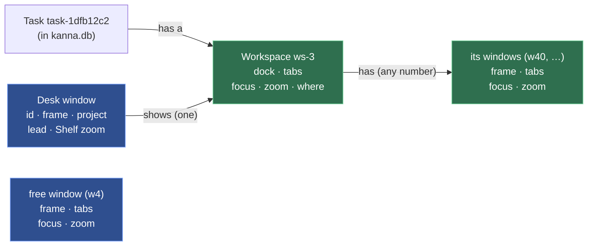
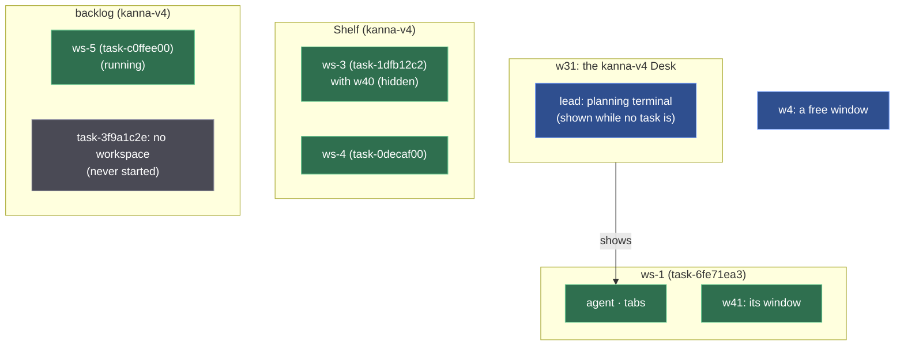
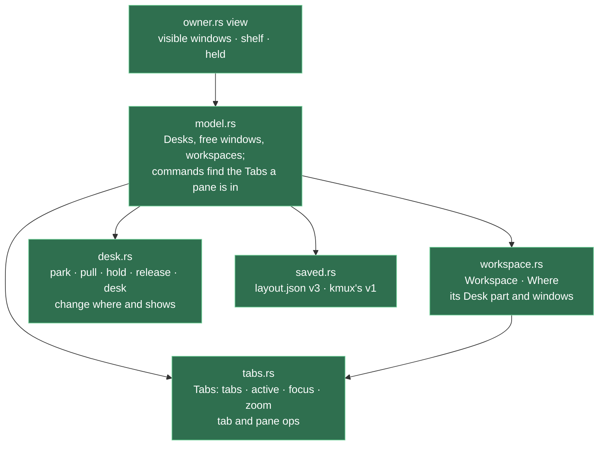
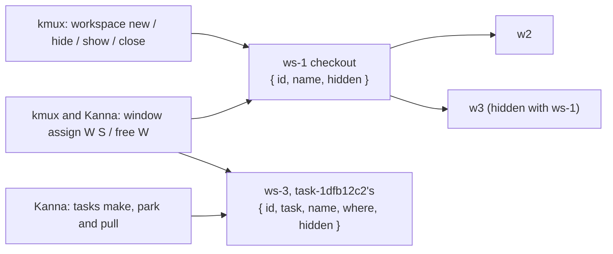

# Workspaces

**Status:** built · **Builds on:** [layout](layout.md), [Desk](desk.md), [tasks](tasks.md), [presenting](presenting.md)

A task is a unit of work. Its **workspace** is how it's presented: its agent docked beside its tabs, with the shown tab, focus and zoom, plus any windows of its own. A Desk window shows one workspace at a time. Park, pull, hold and shelve change which Desk shows which workspace, and a workspace's windows are on screen only while it's on a Desk. A command from a task's pane goes to its own workspace, wherever that is, and the reply names the task and where it is.

## Contents

1. [The model](#1-the-model)
2. [What moves a workspace](#2-what-moves-a-workspace)
3. [Commands: target and reply](#3-commands-target-and-reply)
4. [Kinds of window, and the planning terminal](#4-kinds-of-window-and-the-planning-terminal)
5. [Saved state](#5-saved-state)
6. [Code and tests](#6-code-and-tests)
7. [The branches waiting for review](#7-the-branches-waiting-for-review)
8. [Backport to kmux](#8-backport-to-kmux)
9. [Decisions](#9-decisions)
10. [Glossary](#10-glossary)

## 1. The model



- **A workspace has an ID of its own,** `ws-1`, `ws-2`, …, made by the layout, which knows nothing of tasks. **A task has a workspace:** the daemon's record of the task names it ([workspace list](workspace-list.md#a-task-has-a-workspace)). It keeps it from start to Done, wherever it goes. A workspace with no task (a pane docked by hand) is just a workspace.
- **A workspace has a Desk part and windows of its own.** The Desk part (the docked agent and its tabs) is what a Desk window shows. Its own windows are ordinary windows with their own IDs and frames.
- **A window isn't a workspace.** It's a Desk, one of a workspace's windows, or free (in no workspace).
- **`where`** is one of: on a Desk (which one), on the Shelf, or in the backlog. A workspace is in exactly one place.
- **Only a workspace on a Desk is visible,** its windows included. On the Shelf or in the backlog, its Desk part and all its windows are hidden; their panes keep running, the Desk part at the Desk's size ([pane sizes](pane-sizes.md)) and each window at its frame.



Green: workspaces and their windows. Blue: Desks and free windows. Grey: no workspace. A backlog task gets a workspace when it first starts; until then it's only a name and a first message ([tasks](tasks.md#3-the-backlog)).

## 2. What moves a workspace

Each one changes `where`, a Desk's `shows`, or which workspace a window or pane is in. None copies tabs, focus or zoom.

| Action | Workspace | On screen |
|---|---|---|
| `kanna task start` (backlog) | new `ws-N`, docked agent, in the backlog; the task records it | — |
| Move to Shelf (`shelve`) | new, or the held one, onto the Shelf | — |
| `pull` onto Desk W | Shelf → on W | W shows it and its windows open at their frames; the one W showed goes to the Shelf and its windows close |
| `park` | on a Desk → Shelf | the Desk shows its lead and the Shelf; the workspace's windows close |
| Move to Backlog (`defer`, `hold`) | Desk or Shelf → backlog, as it is | as park |
| `stop` | unchanged | unchanged |
| `done` | closed with its panes and its windows | as park |
| Its agent's pane closes | gone: its tabs leave for a new free window, its windows become free | — |
| `open --window new`, or a tab torn off, from the workspace | a new window of the workspace | on screen if the workspace is |
| A tab torn off a free window | — | a new free window |
| `move PANE --window W`, a tab dragged to W | the pane or tab joins W's workspace, or W if it's free | — |
| `kanna window assign W task-1dfb` | W becomes one of task-1dfb's windows | W stays if task-1dfb is on a Desk, else it's hidden with task-1dfb |
| `kanna window free W` | W leaves its workspace | W opens if its workspace was hidden |

A pane belongs to the workspace it's in. Moving it to another workspace's window moves it to another task, so that's always a deliberate drag or `move`, never a side effect of where a task happens to be shown.

## 3. Commands: target and reply

**The caller** is the CLI's `$KANNA_PANE`. A command that names a pane or tab acts where *that* pane or tab is. One that names nothing acts where the caller is: its workspace's Desk part, one of its windows, or a free window. `--window W` aims at W, whoever's it is; a task's pane may do that, though it rarely needs to, and the reply names W's workspace so the agent sees where its pane went.

| Command | From a task's pane (task-1dfb) | From a pane in a free window (w4) |
|---|---|---|
| `open` | beside the caller: as asked when on screen; a new tab when hidden | into w4, as kmux |
| `open --window new` | a new window of task-1dfb | a new free window |
| `focus PANE` / `--tab` | that pane's or tab's shown tab and focus; its window becomes key only if on screen | as kmux |
| `focus --window W` | makes W key; for a hidden window, an error saying where it is | as kmux |
| `zoom PANE` | that pane's zoom, on screen or not | as kmux |
| `comment` | the markdown pane it opens or finds is beside the caller | in w4 |
| `move PANE --window W` | into W | as kmux |
| `window assign W TASK\|WORKSPACE` / `window free W` | puts W in that workspace, or frees it ([4](#4-kinds-of-window-and-the-planning-terminal)) | the same |
| `close` | a pane, a tab, or `--window W` (and its panes) | as kmux |
| `workspace list` | its workspace: dock, tabs, panes, shown tab, focus and zoom, and its windows ([workspace list](workspace-list.md)) | w4 |

Replies say which workspace and where it is. A window is named when it's on screen, or when it's one of the workspace's own:

| Case | Reply |
|---|---|
| open, task-1dfb (ws-3) on Desk w31 | `opened p5 in ws-3 on w31 (task-1dfb), tab t9: running` |
| open, ws-3 on the Shelf | `opened p5 in ws-3 (task-1dfb, on the Shelf), tab t9: running` |
| open, ws-3 in the backlog | `opened p5 in ws-3 (task-1dfb, in the backlog), tab t9: running` |
| open in ws-3's window w40, ws-3 on the Shelf | `opened p5 in ws-3's w40 (task-1dfb, on the Shelf), tab t9: running` |
| open `--window w31` from task-1dfb, w31 shows ws-1 | `opened p5 in ws-1 on w31 (task-6fe7), tab t9: running` |
| open in a free window | `opened p5 in window w4, tab t9: running` |
| focus, ws-3 in the backlog | `focused spec in ws-3 (task-1dfb, in the backlog)` |
| focus, ws-3 on a Desk | `focused spec in ws-3 on w31 (task-1dfb, key window)` |
| zoom, hidden | `spec is zoomed in ws-3 (task-1dfb, on the Shelf) (run again to unzoom)` |
| comment, hidden | `opened p6 in ws-3 (task-1dfb, on the Shelf) · spec.md:12` |
| assign to a task on the Shelf | `assigned w41 to ws-3 (task-1dfb, on the Shelf: hidden until it's pulled)` |
| free | `w41 is free` |

Layout replies carry `workspace: {id, where, hidden}` (`where`: `{desk}`, `"shelf"` or `"backlog"`; `hidden` unless it's on a Desk, as kmux's), or null in a free window, beside `window` and `tab`. `window` is the window's ID, or null for a hidden Desk part. The daemon adds `task` and `name` to a workspace that's a task's, in every reply. `kanna workspace list --all --json` has `workspaces`, each with its dock, tabs, shown tab, focus and zoom, and `hiddenWindows`, the windows of workspaces off screen.

## 4. Kinds of window, and the planning terminal

- **A Desk** is a project's window: it shows its lead (the planning terminal) and the Shelf, or one workspace's Desk part. It holds no tabs of its own: a pane opened onto the Shelf gets a new window ([zoom](zoom.md), [planning agent](planning-agent.md)). Its ID names the place.
- **A workspace's window** belongs to that workspace: its ID stays with it through park and pull, and it's visible only while the workspace is on a Desk.
- **A free window** belongs to no workspace: nothing parks, pulls or docks there. It behaves as kmux's window, so kmux's protocol cases pass on it.
- **A window joins or leaves a workspace** when it's made (one made from a task's pane or torn off its tabs is the task's; one made from a free window is free), or with `kanna window assign W TASK|WORKSPACE` and `kanna window free W`, and the Window menu's Assign Window to Task (the project's started tasks) and Free Window ([menus](menus.md)). Both are kmux's `window` command, a `command` step as `move-tab` is, with a `ws-N` or a pane as the `workspace`; the daemon turns a task's ID into its workspace's before the layout sees it. Refused: a Desk (`desk`: a Desk is a place, not a task's), a window with a lead (`lead`: a Quiz window stays its agent's), and a task with no workspace yet (`not_started`: "task-3f9a hasn't started, so it has no workspace yet").
- **The planning terminal never moves.** It's its Desk's, not a task's: park and pull swap the workspace beside it, and `move` refuses it.

## 5. Saved state

`layout.json` is `version: 3`: `windows` holds Desks and free windows, and every workspace is in one list with its own windows.

```json
{ "kmux": "state", "version": 3, "key": "w31", "counters": { "tab": 12, "window": 41, "workspace": 5 },
  "windows": [
    { "id": "w31", "frame": {}, "desk": true, "project": "/work/app", "lead": { "pane": "p2", "width": 0.4 }, "shows": "ws-1" },
    { "id": "w4", "frame": {}, "tabs": [], "active": "t3", "focused": "p7", "zoomed": null }],
  "workspaces": [
    { "id": "ws-1", "where": { "desk": "w31" },
      "dock": { "pane": "p12", "edge": "left", "width": 0.4, "frozen": true },
      "tabs": [], "active": "t9", "focused": "p13", "zoomed": null, "tabCount": 3,
      "windows": [{ "id": "w41", "frame": {}, "tabs": [], "active": "t12", "focused": "p20", "zoomed": null }] },
    { "id": "ws-3", "where": "shelf", "parkedAt": 1792183838, "dock": {}, "tabs": [], "windows": [{ "id": "w40" }] },
    { "id": "ws-5", "where": "backlog", "dock": {}, "tabs": [], "windows": [] }] }
```

- **Version 1 loads.** A window with a dock becomes a Desk showing a workspace made of its dock and tabs (`planner` → `lead`). Any other Desk stays a Desk; every other window is free. Each `parked` entry becomes a workspace on the Shelf, or in the backlog when `backlog` is set. The next save writes version 3.
- **Version 2 loads.** Its workspaces were named by their task (`task-1dfb12c2`) or their agent's pane; each gets a `ws-N` ID, its windows' `workspace` and its Desk's `shows` following, and its `task` is dropped.
- **The daemon finds each task's workspace** from the listing it asks for once the app attaches: the workspace whose dock is the task's agent pane. A start records the workspace the `open --dock --frozen` reply names. Both go in the task's `doc` in `kanna.db` ([database](database.md)).
- **kmux's debug state stays kmux's version 1.** `debug.saveState` writes a Desk with what it shows inline and each hidden workspace in `parked`, and a workspace's window names it (`workspace`), so kmux's protocol cases pass and `debug.restoreState` reads it back.
- **The daemon's own state stays as it is.** `kanna.db` keeps `tasks.pane` (the agent) and `place`; `terminals.json` keeps the terminals. The layout's `where` is what's shown, and the db's `place` is the task's history ([database](database.md)).

## 6. Code and tests



- **One `Tabs`** (tabs, shown tab, focus, zoom) is what a free window, a workspace's Desk part and each of its windows hold. Tab and pane ops are written once on it, whether it's visible or not.
- **desk.rs** keeps the task actions only: each changes `where`, and a Desk shows the workspace whose `where` is that Desk. A window is one of a workspace's by its `workspace` field. Tab and pane ops find the `Tabs` a pane is in (a window's or a workspace's Desk part), shown or not.
- **owner.rs** `view` lists the visible windows (Desks, free windows, and the windows of workspaces on a Desk), each with its `workspace`; `shelf` and `held` read workspaces by `where`, and `held` includes their windows' panes. A window that leaves or joins the view closes or opens as any window does, so the Swift app only learns the `workspace` field and the two Window menu items.
- **kanna CLI:** `output.rs` writes the replies in [3](#3-commands-target-and-reply); `window assign` and `window free` are new in `commands.rs`; `crates/kanna/tests/cli.rs` checks them.
- **kanna-mux tests:** the owner tests on parked and held tasks (`a_task_parks_onto_the_shelf…`, `a_task_held_in_the_backlog…` ×2, `a_task_parks_and_pulls_with_its_zoom…`, `a_parked_task_whose_agent_is_gone…`, `a_pull_onto_a_desk_with_a_task…`) check workspace IDs and `where`. New: a task's `open` lands in its own workspace after another task is pulled onto its old Desk; a workspace's window is hidden on park and opens at its frame on pull; `open --window new` from a task's pane makes its window; `window assign` hides a window in a hidden workspace and `window free` shows it, and both refuse a Desk; replies name the workspace; a workspace has an ID of its own and goes when its agent does; version-1 and version-2 files load and save as version 3, their workspaces given `ws-N` IDs with their windows following. `protocol_cases` (kmux's) pass, natively and behind `LayoutOwner`.
- **e2e:** `backlog_runners` (the presenting task) checks the focus and open replies from a held task, and that its tabs are still in `t8`'s workspace after another task is pulled onto the Desk. `desk_shelf`, `move_to_backlog`, `backlog_and_back`, `shelf_zoom` and `layout_restored` read workspaces from `kanna workspace list --all --json`; `desk_shelf` also parks and pulls a task with a window of its own, and assigns a free window to the task and frees it.
- **Skills:** `kanna-tasks` says to open without `--window`, and that the reply names your task and where it is.

## 7. The branches waiting for review

- **Quiz window docks its agent** (`quiz-window-docked`) renames `planner` to `lead` and lets a window that isn't a Desk have one (the Quiz window). That fits: a lead is a window's, never a workspace's, so a Quiz window is a free window with a lead. Land it first; this spec says `lead` throughout.
- **Move to a window makes a new tab** (`move-window-new-tab`): `move PANE --window W` makes a new tab at the end of W, which is in W's workspace, or W if it's free. No conflict.

## 8. Backport to kmux

kmux has workspaces without Kanna's Desk, Shelf and tasks, through [the kmux subtree](kmux-subtree.md) (kmux files only, a kmux branch and PR); [kmux's spec, 3.8](../../references/kmux/docs/kmux-spec.md#38-workspaces) has the rules.



- **A kmux workspace** is a named group of windows, shown or hidden, with kmux's own IDs (`ws-1`, apart from `w1`, `t1`, `p1`; a saved `s1` still loads). It has no Desk part: that's Kanna's.
- **Commands:** `workspace new [NAME]`, `workspace hide S`, `workspace show S` (its windows at their frames, its last one key), `workspace close S` (its windows and panes), `window assign W S`, `window free W`, `workspace list [--all]` (the caller's window and its workspace, from `$KMUX_PANE`; `--all` every window and workspace). The app's Window menu has Assign Window to Workspace (the workspaces, and New Workspace) and Free Window, as Kanna's.
- **No caller rules:** kmux has no caller, so `open` still goes to the key window or `--window`, and a new window is free. A hidden window is never the key window, and `focus` on it is refused (`hidden`), as in Kanna.
- **Replies** name the workspace as `{id, name, hidden}`: `opened p5 in ws-1's w40 (hidden), tab t9: running`.
- **Saved state:** kmux's state file, still version 1, gains `workspaces` (`id`, `name`, `hidden`) and each window its `workspace`.
- **In Kanna,** a task's workspace is a kmux workspace plus its Desk part, with the same `ws-N` IDs; the Shelf and the backlog are both hidden to kmux, so its replies say `hidden` too. Kanna's `window` takes kmux's `workspace` (a `ws-N`, a pane, or a task's ID, which the daemon turns into its workspace's) and passes kmux's `window` case; the cases that make workspaces with `workspace` are skipped, since Kanna's `workspace` command has only `list` (tasks do the rest), as the runner skips any case needing a command Kanna lacks ([kmux is the reference model](kmux-reference.md)). The CLI check counts `workspace list` as kmux's and the rest of `workspace` as kmux's own, and `window` as documented for tasks.

## 9. Decisions

1. **The name is workspace.** A task is the unit of work; its workspace is its presentation. The Shelf and the backlog hold tasks, and each started task's workspace goes with it, hidden; the Shelf draws its cards as it does now.
2. **A task's pane may open into another window** with `--window W`. It's rare, not wrong; the reply names where it landed.
3. **A window isn't a workspace.** A workspace can have several windows; a window is a Desk, a workspace's, or free.
4. **Off the Desk, a whole workspace is hidden,** its windows included, and pulled, they come back at their frames.
5. **A window can be assigned to a task's workspace or freed** (`kanna window assign`, `kanna window free`, and the Window menu).
6. **kmux gets workspaces too** ([8](#8-backport-to-kmux)), after Kanna's are built.
7. **Backlog task task-1dfb12c2** ("Off-screen open and focus replies name the right window") is covered by [3](#3-commands-target-and-reply) and comes off the backlog when the build task is made.
8. **kmux gets workspaces without caller rules** ([8](#8-backport-to-kmux)): it has no caller, so its `open` keeps going to the key window; only workspaces, hidden windows and replies are backported.

## 10. Glossary

| Term | Meaning |
|---|---|
| **Task** | A unit of work: one agent in one repo ([tasks](tasks.md)) |
| **Workspace** | How a task is presented: its Desk part (agent dock, tabs, shown tab, focus, zoom) and its windows, with an ID of its own (`ws-3`) |
| **Desk part** | The docked agent and its tabs: what a Desk window shows of a workspace |
| **Desk** | A project's window: its lead and the Shelf, or one workspace's Desk part |
| **Free window** | A window in no workspace, as kmux's |
| **Where** | A workspace's place: on a Desk, on the Shelf, or in the backlog |
| **Caller** | The pane a CLI command runs in (`$KANNA_PANE`); where it is is the default target |
| **Lead** | A window's own agent (the planning terminal on a Desk), never a task |
