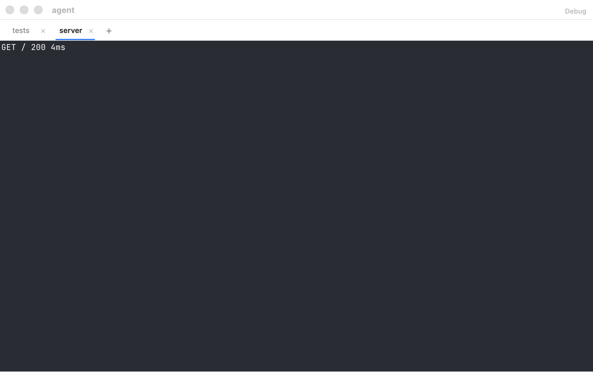
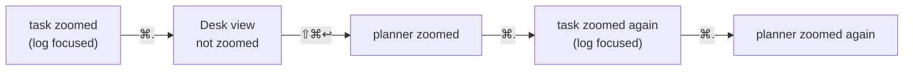
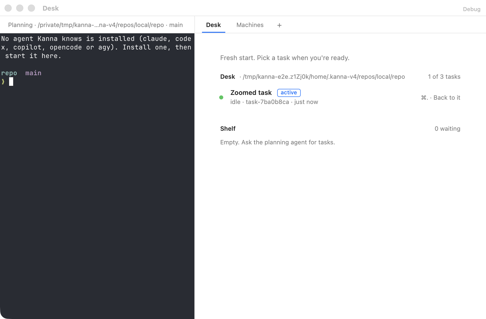

# Zoom

**Status:** built (2026-10-12), in kmux and Kanna; the Desk's two zooms built (2026-10-13), in Kanna · **Reference:** kmux ([`references/kmux`](../../references/kmux/docs/kmux-spec.md), its §5 and protocol cases `focus.json` and `dock.json`) · **Used by:** [Docked pane](docked-pane.md), [Desk](desk.md)

**Zoom** is a window's mode. ⇧⌘↩ turns it on and off; while it's on, whichever pane has focus fills the window (a tab's pane under the tab bar, so you still see which tab you're on), and the layout stays as it was underneath. You move around as usual, by pane (⌘] ⌘[) or by tab (⇧⌘] ⇧⌘[), and see one pane at a time.

| Zoom off: the agent docked, the server tab split in two | Zoom on, with the request log focused |
|---|---|
|  |  |

## Contents

1. [What fills what](#1-what-fills-what)
2. [Rules](#2-rules)
3. [Keys and CLI](#3-keys-and-cli)
4. [How it's built](#4-how-its-built)
5. [Glossary](#5-glossary)

## 1. What fills what

| Focused pane | Zoom off | Zoom on |
|---|---|---|
| a tab's pane |  |  |
| the docked pane, with tabs |  |  |
| the docked pane, no tabs |  |  |

A zoomed tab's pane keeps the tab bar: the bar runs across the top of the whole window, its tab selected, and the pane fills the rest; the docked pane is hidden. A zoomed docked pane fills the window with no tab bar. In a window without a docked pane, the focused pane fills the tab, under the tab bar.

### On a Desk: the task's zoom and the Desk view's

A Desk keeps two zooms: each task's, which goes with the task, and the [Desk view](desk-view.md)'s. ⇧⌘↩ and `kanna zoom` turn on the one showing.

| The task, zoomed on its log | ⌘.: the Desk view keeps its own zoom (off) | ⇧⌘↩ there zooms the planner |
|---|---|---|
|  |  |  |

## 2. Rules

- **A mode of the window, not a mark on a pane.** While zoom is on, the window shows only its focused pane, filling the window. Each window has its own.
- **The tab bar stays for a tab's pane.** A zoomed tab's pane fills the window under the tab bar, which spans the window; a zoomed docked pane (or a Desk's planning terminal) has no tab bar.
- **Moving around keeps it on.** Next and Previous Pane, Next and Previous Tab, clicking a tab, and `kanna focus` move focus as they do with zoom off, and the pane they land on fills the window. Next Pane goes through the docked pane and the shown tab's panes, as it does with zoom off.
- **Only ⇧⌘↩ turns it off** (or `kanna zoom`), showing the layout again with focus where it ended up.
- **Opening, closing or moving panes keeps it on.** A pane opened into the window is focused, so it's the one shown; when the focused pane closes or moves away, the pane focused after it is shown.
- **A task carries its zoom.** The Desk view leaves a task's zoom with it, and showing the task again, or making it active later, brings it back, focused where it was; a task new to the Desk comes unzoomed. The Desk view's zoom stays with the window.
- **Saved** in the saved layout with the window, so it's on after a relaunch: each task's, active or not, and the Desk view's.

**The same in kmux.** kmux gets the mode, and Kanna's whole-window fill: a zoomed tab pane covers the docked pane there too, where today it fills only the tabs' side. Kanna alone keeps the tab bar over a zoomed tab pane; kmux's tab pane covers its tab bar too.

## 3. Keys and CLI

| Key or command | Does |
|---|---|
| ⇧⌘↩ (Pane menu, Zoom; Ghostty's `toggle_split_zoom`) | Turn the key window's zoom on or off |
| ⌘] / ⌘[, ⇧⌘] / ⇧⌘[ | Next or Previous Pane or Tab; with zoom on, the pane they land on fills the window |
| `kanna zoom PANE` | Focus PANE and turn its window's zoom on, or off if it's on |
| `kanna focus PANE` | Focus PANE; with zoom on, it fills the window |
| `kanna workspace list` | Each window's and workspace's `zoomed` pane: its focused pane while the zoom of what's showing (a task or the Desk view) is on |

## 4. How it's built

- **The core** (kmux's `Window.zoom`, then `crates/kanna-mux/src/tabs.rs`'s) keeps one flag per set of tabs (`Tabs`: a free window's, a workspace's Desk part, each of its windows). The zoomed pane is its focused pane while it's on (`Tabs::zoomed()`), so nothing moves a zoom from pane to pane or clears it when panes come and go.
- **A Desk's own flag.** A Desk's own `Tabs` hold no tabs, only the Desk view's focus (its planning terminal) and zoom; a Desk showing a task draws the task's workspace, whose zoom is its own. ⌘. and making a task active change which workspace a Desk shows and copy nothing (`crates/kanna-mux/src/desk.rs`). kmux has no Desk, so its windows keep the one flag.
- **The protocol and state file** keep their `zoomed` field: `list` and the saved layout show the focused pane while zoom is on, and a saved `zoomed` turns zoom on, focused there, after a relaunch. Each workspace saves its own `zoomed`, and a Desk the Desk view's (as `shelfZoom` in kmux's version 1).
- **The view** the app draws has the focused pane as the window's whole tree (`root`), or no tree when it's the docked pane or a Desk's planning terminal, which then fills the window ([layout](layout.md)). The daemon's view doesn't say whether the tab bar shows: the app (`WindowController.arrange`) hides it only when nothing is on the tabs' side, as with the docked pane zoomed, and otherwise lays the bar across the space the tab's pane fills.
- **kmux first.** The mode and the whole-window fill went into kmux (its core, reference model, protocol cases, app, e2e and spec), then into Kanna with a subtree pull.
- **Checked by** kmux's protocol cases (`focus.json`, `dock.json`), run in kmux, its reference model and `kanna-mux`; the `kanna-mux` owner test for the mode across tabs, a new pane and a relaunch; and e2e `windows_tabs_ui` (⌘] ⌘[ and ⇧⌘] ⇧⌘[ with zoom on, a new tab's pane shown, the tab bar shown) `docked_pane` (the docked pane with and without tabs and no tab bar, ⌘] from it into the tabs, a tab's pane under a tab bar across the window, clicking tabs with zoom on), and `desk_zoom` (a Desk's two zooms through ⌘. both ways, and after a relaunch, the tab bar shown only for the task's pane; `debug.snapshot` reports `tabBar.shown`); the `kanna-mux` owner test for a task's zoom and the Desk view's. `docked_pane`'s and `desk_zoom`'s snapshots are this spec's pictures.

## 5. Glossary

| Term | Meaning |
|---|---|
| **Docked pane** | A window's one pane outside its tabs, along its left or right edge ([spec](docked-pane.md)). |
| **Protocol cases** | kmux's JSON request-and-reply scripts that kmux, its reference model and Kanna's core all run. |
