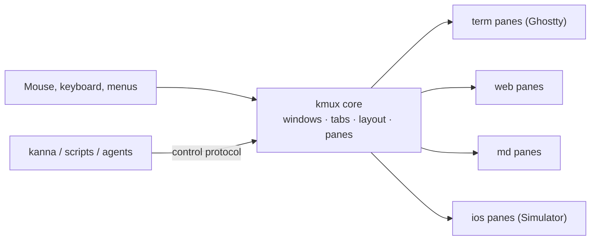
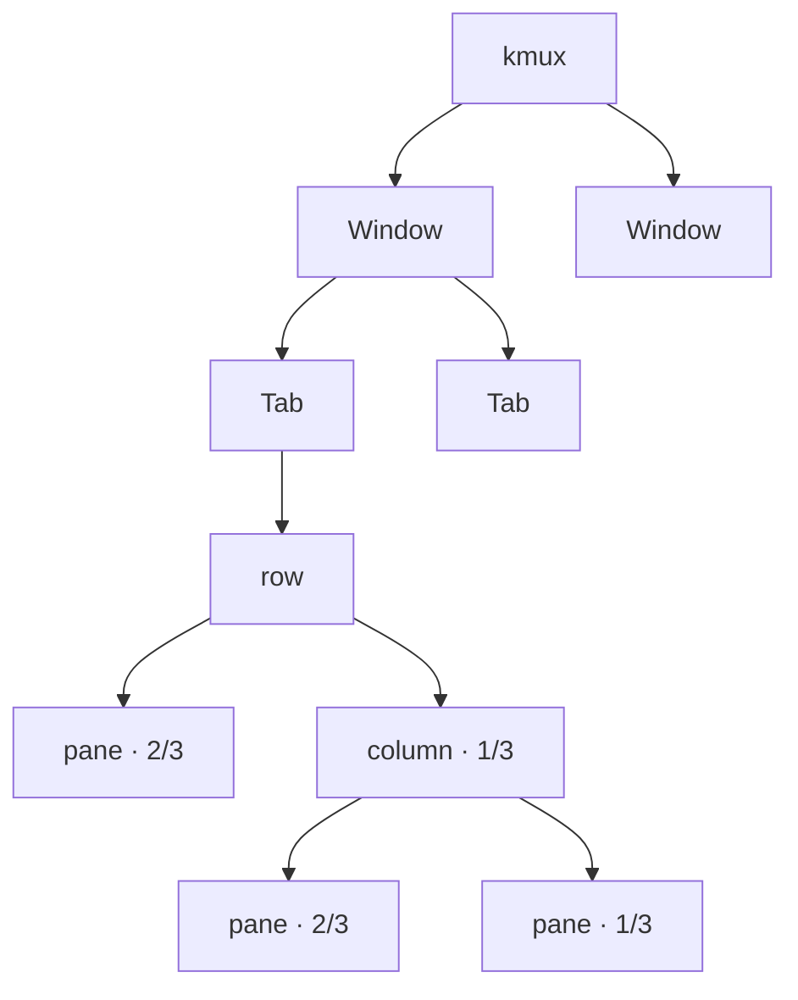
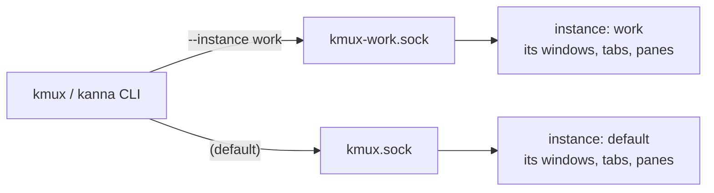
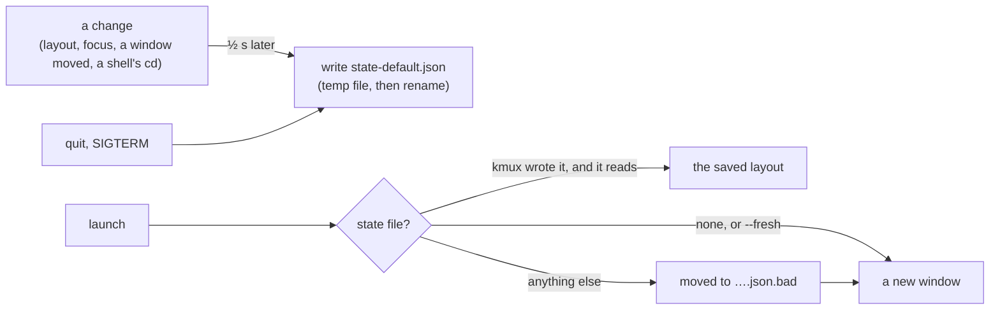
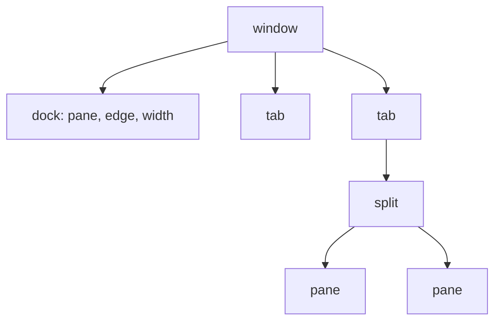
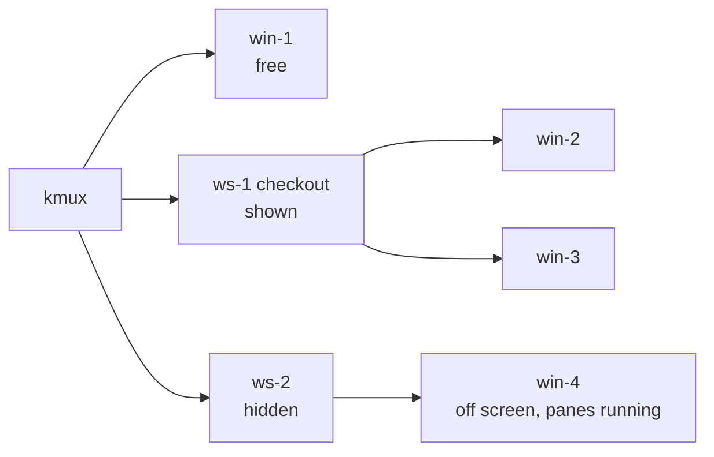
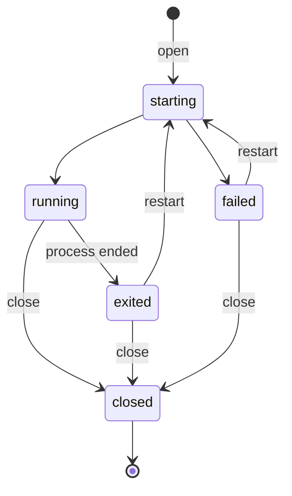

# kmux — Specification

> **Status:** v0.8 · **Last updated:** 2026-10-17
>
> **Reference model:** [`reference/kmux/index.html`](../reference/kmux/index.html). Open it in a browser and try it.
> The model is the source of truth for kmux's design and behaviour. This document summarises what the model shows and lists what it doesn't answer yet. If the two disagree, the model wins, and this document should be fixed.
>
> **Related:** the [kanna spec](../../kanna-v4/docs/kanna-spec.md) (separate kanna repo), a CLI that can drive kmux and other muxes. kmux also has its own `kmux` CLI (`crates/kmux`).

## Table of Contents

1. [Summary](#1-summary)
2. [What the Model Captures](#2-what-the-model-captures)
3. [Windows, Tabs and Layout](#3-windows-tabs-and-layout)
4. [Panes](#4-panes)
5. [Menus and Shortcuts](#5-menus-and-shortcuts)
6. [Moving Windows, Tabs and Panes](#6-moving-windows-tabs-and-panes)
7. [Control Protocol](#7-control-protocol)
8. [Decisions and Open Questions](#8-decisions-and-open-questions)
9. [Glossary](#9-glossary)

---

## 1. Summary

kmux is a native macOS **mux**. It has one or more windows of tabs, and each tab is split into **panes** that show Ghostty terminals, web pages, markdown files or the iOS Simulator. Panes have no chrome. Everything is done through menus, shortcuts and dragging, or by other programs through the **control protocol**.

UI actions and protocol requests go through the same core, so a click and a `kanna` or `kmux` command always behave the same way. Several **instances** of kmux can run at once, each with its own windows and socket ([3.4](#34-instances)).




---

## 2. What the Model Captures

| Characteristic | Captured? | Notes |
|----------------|:---------:|-------|
| Look: windows, tabs, chromeless panes, menus | ✅ | |
| Layout behaviour: splits, sizes, dragging, moving | ✅ | Includes moving between windows. |
| Pane lifecycle and error states | ✅ | |
| Shortcuts and menus | ✅ | The browser keeps ⌘N, ⌘T, ⌘W, ⇧⌘W and ⌘\`, so the model also accepts ⌥ in place of ⌘. |
| Control-protocol commands and replies | ✅ | The model's console (marked **MOCKUP ONLY**) stands in for kanna. It is not part of kmux. |
| Real terminals, web views, markdown rendering and simulators | ❌ | Simulated. See [section 8](#8-decisions-and-open-questions). |
| Persistence: the layout coming back after a restart | ✅ | Reloading the model's page is restarting kmux; **Reset** starts fresh. See [3.6](#36-persistence). |
| Transport (socket), performance | ❌ | See [section 8](#8-decisions-and-open-questions). |

---

## 3. Windows, Tabs and Layout

### 3.1 Structure

kmux has any number of **windows**. A window holds **tabs**. Each tab holds a tree of **splits** (`row` = side by side, `column` = stacked) with panes at the leaves.




- **Key window:** one window is the key (front) window. Shortcuts, menus and protocol requests without a `window` act on it. Clicking a window makes it key.
- **Focus:** each window remembers its focused pane and whether zoom is on, and each tab remembers its last focused pane.
- **Titles:** new tabs are named `Tab 1`, `Tab 2`, … in each window. Double-click a tab to rename it: Enter or clicking away saves, Escape cancels. Clients rename tabs with `rename-tab`. A window's title is its active tab's title.
- **Empty containers close:** closing a tab's last pane closes the tab, and closing a window's last tab closes the window, unless it has a docked pane ([3.7](#37-docked-pane)). With no windows left, kmux offers to open a new one.
- **Closing a tab or window** closes all of its panes.
- **New windows** cascade down and to the right of the key window.

### 3.2 Sizes

Every size is a **fraction of its parent split**. The fractions in a split always add up to 1, and they stay proportional when the window is resized.

| Action | Rule |
|--------|------|
| New split | The new pane gets `size` (default **1/2**) of the focused pane's space. |
| Split direction | `right` or `down` when given. Otherwise (`auto`), side by side if the focused pane is wider than it is tall, stacked if not. |
| Same-direction parent | The new pane becomes a sibling in that split, not a nested split, so three "split right"s give three columns. |
| New pane focus | The new pane takes focus, and its window becomes key. |
| Close | The siblings share the freed space in proportion to their sizes. A split left with one child disappears. |
| Resize | The pane gets the new fraction, and its siblings share the rest in proportion to their sizes. |
| Divider drag | Snaps to ¼, ⅓, ½, ⅔ or ¾ when within 1.5% of one. A tooltip shows both fractions, e.g. `2/3 \| 1/3`. Panes can't be dragged below 80 px. |


### 3.3 Arrange

`arrange` replaces a window's active tab layout with a given tree (see [7.2](#72-layout-trees)):

- The tree can name panes from any window, and those panes move into this tab.
- Children without a size share whatever space is left. If every child has a size and they add up to less than 1, they are scaled up to fill the space.
- If the sizes add up to more than 1, the request is rejected and nothing changes.
- Panes in the tab that the tree doesn't mention move to a new tab called `unarranged`.

### 3.4 Instances

An **instance** is one running copy of the kmux app, with its own windows and its own control socket. Several can run side by side, for example one per project.



- **Names:** the default instance is called `default`. Other names use letters, digits, `-` and `_` (up to 32).
- **Sockets:** all in `~/Library/Application Support/kmux/`. The default instance listens on `kmux.sock`, and one named `work` on `kmux-work.sock`.
- **Starting one:** `kmux --instance work …` starts `work` if it isn't running. In the app, **kmux → New Instance** starts one named `2`, `3`, ….
- **Telling them apart:** a named instance shows its name in its window titles (`Tab 1 — win-1 · work`) and at the top of the kmux menu. `capabilities` reports the instance name.
- **Inside a pane:** terminals get `KMUX_INSTANCE`, `KMUX_SOCKET` and `KMUX_TERMINAL` (the terminal's own ID, `term-3`), so `kmux` run in a pane controls the instance that owns it. A terminal brought back by a restart ([3.6](#36-persistence)) also gets `KMUX_RESTORED=1`.
- **Quitting:** an instance removes its socket when it quits, including when it is sent SIGTERM, SIGINT or SIGHUP.

### 3.5 Staying in the background

kmux launches in front by default. With `--bg` (on the app or the CLI, or `KMUX_BG=1`), for tests and scripts that start kmux over and over:

- kmux launches without becoming the active app.
- While it isn't the active app, windows it opens or focuses go **just behind** the front window of the app in use, not on top of it. Once the user switches to kmux, windows come to the front as usual.

### 3.6 Persistence

When kmux starts again, its layout comes back: windows where they were, their tabs (titles, order, the active tab), the splits and their sizes, focus and zoom, pane names, and what each pane shows. Panes, tabs and windows keep their IDs.

| Pane | Saved | When kmux starts again |
|------|-------|------------------------|
| `term` | `cmd`; `cwd` (the shell's current directory when it reports one, else the one it started in) | A **new** terminal in that directory, running `cmd` again. The old output and processes are gone. |
| `web` | `url`, whether it keeps `history` | Loads the URL again (with empty history). |
| `md` | `path`, magnification | Shows the file again at that magnification. |
| `ios` | `app`, `device` | Relaunches the app on the device. |



- **Products that keep terminals alive:** kmux itself never keeps a process across a restart. A product built on kmux can: its build names a **terminal wrapper** (`KMUX_TERMINAL_WRAPPER` in `scripts/build-kmux.sh`, a program inside the app). kmux then runs every terminal through it, `WRAPPER` for a shell or `WRAPPER -- $SHELL -c CMD` for a command, and a restored terminal gets `KMUX_RESTORED=1` (`KANNA_RESTORED` in Kanna), so the wrapper can reattach a session that outlived the app instead of starting a new one. kmux knows nothing else about it. Kanna's keeper works this way.
- **Where:** one file per instance, next to its socket: `~/Library/Application Support/kmux/state-default.json` (`state-work.json` for an instance named `work`). A kmux on a socket elsewhere (`$KMUX_SOCKET`, as tests use) keeps it beside that socket: `/tmp/x.sock` → `/tmp/x.state.json`. Other brands use their own folder (Kanna: `…/kanna/`).
- **When:** half a second after a change, and when kmux quits (⌘Q, SIGTERM, SIGINT or SIGHUP). Writes are atomic: a temporary file, flushed, then renamed over the old one.
- **Format:** JSON with a `version` (now 2): the workspaces (`{ id, name, hidden }`), the windows (with frames, a `dock` `{ pane, edge, width, frozen? }` when they have one, and a `workspace` when they're in one), their tabs and layout trees (pane IDs, exact sizes), focus and zoom, and the panes. A file without `dock`, `workspaces` or `workspace` loads as before. A terminal also has a `session`, reserved for re-attaching hosted terminals later and unused for now.
- **Older files:** a version 1 file (panes `p1`, tabs `t1`, windows `w1`, workspaces `s1`) loads with its IDs renamed: each pane takes its content's kind and keeps its number (`p3` showing a web page is `page-3`), tabs become `tab-N`, windows `win-N` and workspaces `ws-N`.
- **Only kmux's own file:** restoring runs terminal commands again, so kmux restores a file only if it is a regular file (not a link), owned by the user, readable and writable by no one else (mode 0600), in a folder no other user can write to. kmux never restores from a path a client gives it.
- **Never in the way:** a file that fails these checks, isn't valid, or has another version is moved aside to `….json.bad`, and kmux starts with a new window. So does a file with no windows left.
- **Starting fresh:** `--fresh` (on the app or the CLI, or `KMUX_FRESH=1`) opens a new window instead; the saved layout is replaced at the next save. `KMUX_NO_STATE=1` turns saving and restoring off (for tests on shared sockets).
- **Tests:** `debug.saveState` replies with the state kmux would save, and `debug.restoreState` (with a `state`, or the last saved one) replaces everything with it, as a launch would. A bad state is refused with `bad_request` and changes nothing.

### 3.7 Docked pane

A window can have one **docked pane**: it belongs to the window, not to a tab, along its left or right edge, and stays put while the tabs switch beside it. Any pane type can be docked.




| Rule | |
|------|---|
| One per window | Left (the default) or right. Docking another pane where one already is sends the old one to a new tab in that window, not shown. |
| Width | A fraction of the window, default **2/5**. Dragging its divider snaps like a split's (and to 2/5); `resize` on the docked pane sets it. Saved with the window. |
| Always shown | Switching tabs leaves it alone. The tab bar spans only the tabs' side. A window whose last tab closes keeps its docked pane. |
| Closes only with its window | ⌘W in it does nothing, the Pane menu has no Close for it, and `close` on it fails with `docked: it closes with its window`. If its program exits it shows **exited**, and `restart` starts it again. |
| Stays with its window | Moving or dragging a tab to another window leaves it. Moving the docked pane itself (`move` to a tab, a window or beside a pane, or a drag) undocks it. Dropping a pane on it swaps the two; its edges take no drops. |
| Focus | Next/Previous Pane go through the window's shown panes in reading order: a left dock first, a right dock last. Switching tabs gives the keyboard to the shown tab, as before. |
| Zoom | The focused pane fills the window, the docked pane or a tab's pane alike. |
| `arrange` | Arranges the shown tab only. A tree that names the docked pane is refused (`docked`). |
| Frozen | Opened with `open --dock --frozen`, the docked pane is frozen for good: `move` on it is refused, edge and window included, and so is anything that would land on it: a pane dropped on it or beside it, or docked in its window (`move --dock`, `open --dock`). The app shows no ⋯ grip on it, no drop over it, and no Move Pane to New Window for it. `resize` still sets its width, and it closes with its window. Saved frozen. Refusals use `frozen`. |


There are no Dock or Undock menu items: docking is done from the CLI or by a client.

```text
$ kmux open --name agent --cmd claude --dock
opened term-4 (agent) docked left in win-1: running
$ kmux move agent --dock right
agent is docked right in win-1 (width 2/5)
$ kmux move agent --tab
```

### 3.8 Workspaces

A **workspace** is a named group of windows, shown or hidden together. A window is in one workspace or none (a **free** window, as every window is until it's assigned). Hidden, a workspace's windows are off screen, their panes still running; shown, they open again where they were.



| Rule | |
|------|---|
| IDs | `ws-1`, `ws-2`, … never reused, with an optional name (unique, and not like an ID). A workspace is referred to by either. |
| Making one | `workspace new [NAME]` makes an empty workspace; `window assign W S` puts a window in it, and `window free W` takes it out (Window → Assign Window to Workspace and Free Window). A window made by `open --window new`, `move --window new` or `move-tab --window new` is free. |
| Hidden | A hidden workspace's windows never take the keyboard: none is the key window (hiding the key window's workspace makes another window key), and `focus` on one of them, a tab or a pane in it is refused (`hidden`). `open`, `move` and `move-tab` with `window` still reach a hidden window, without showing it. A window assigned to a hidden workspace hides; freed, it's on screen again. |
| Shown | `workspace show` opens its windows where they were, and makes its last window key. |
| Closing | `workspace close` closes its windows and everything in them, and the workspace. A workspace whose windows all close stays until it's closed. |
| Replies | A window in a workspace is named with it: `open` adds `workspace: { id, name, hidden }`, the CLI says `opened term-5 in ws-1's win-2 (hidden), tab-9: running`. `list` adds each window's `workspace` (and `hidden: true`), each pane's `workspace`, and the `workspaces` with their windows. |
| Listing | `kmux workspace list` shows your own: the window your terminal (`$KMUX_TERMINAL`) is in, or its workspace with all its windows, and their panes. `--all` shows free windows first, then each workspace with its own; `--json` prints the `list` reply, cut to yours without `--all`. There's no `kmux list`. |

```text
$ kmux workspace new checkout
made ws-1 (checkout): put windows in it with `kmux window assign WINDOW ws-1`
$ kmux window assign win-2 checkout
assigned win-2 to ws-1
$ kmux workspace hide checkout
hid ws-1 (checkout): win-2 off screen, their panes still running
$ kmux open --window win-2 --tab
opened term-6 in ws-1's win-2 (hidden), tab-5: running
$ kmux workspace show checkout
showed ws-1 (checkout): win-2
$ kmux workspace list --all
*win-1
  *tab-1 "Tab 1"  term-1
workspace ws-1 (checkout)
 win-2
  *tab-5 "Tab 1"  term-6
…
```

---

## 4. Panes

### 4.1 No chrome

- Panes have no header, title or border.
- Each pane has a **⋯** drag handle at the top centre. It stays invisible until the pointer is over the handle itself (the open-hand cursor shows where it is), so the pane's top edge stays clear. There is no close button: close a pane with ⌘W, the Pane menu, or by right-clicking it.
- The focused pane has a thin accent outline, shown only in the key window and only when the tab has more than one pane.
- Errors and exits are shown inside the pane itself (see below).


### 4.2 Types

| Type | Shows | Behaviour in the model |
|------|-------|------------------------|
| `term` | A shell or command, in a Ghostty terminal | Runs `cmd` if given. Ctrl+C interrupts. `exit [code]` moves the pane to **exited** and shows the code. |
| `web` | A web page | No address bar. **Open URL** (⌘L) shows a floating address field. A `localhost` URL whose server isn't up shows "Waiting for …" and loads once the server responds. No back/forward history unless the pane is opened with `history` (`kmux open web URL --history`); then **Back** and **Forward** in the Pane menu and `navigate` with `back` or `forward` move through it. |
| `md` | A markdown file, rendered | Like a GitHub page, light or dark with the system. `mermaid` code blocks are drawn as diagrams (an invalid one shows its error in place). Relative images and links work. The pane reloads when the file changes on disk, keeping its scroll position. Zoom is **plain magnification**, for inspecting details such as diagrams: nothing reflows or re-wraps. A pinch magnifies around the fingers (50% to 400%), and a two-finger double-tap toggles a close-up. **Zoom In** (⌘=) and **Zoom Out** (⌘−) step through Safari's steps from 50% to 300% around the middle of the view, and **Actual Size** (⌘0) goes back to 100%. Text and diagrams stay sharp when magnified. Magnified to less than the pane's width, the page sits in the middle; a click anywhere in the pane, beside the page too, focuses it. The magnification stays when the pane moves to another file or reloads. A link to another markdown file opens it in the same pane. Markdown panes always keep back/forward history of the files they showed: following a link or `navigate` with a path adds to it, a reload or restart doesn't. **Back** and **Forward** (Pane menu, right-click menu, the mouse's buttons 4 and 5, `navigate` with `back` or `forward`) return to each file where it was being read, at its scroll position and magnification. A two-finger swipe sideways also goes back (fingers moving right) or forward, as in Safari, once a magnified page can't pan any further that way. Web links (http, https, mailto) open in the browser; other local files are revealed in Finder, never opened (a document must not be able to launch anything). `#anchor` links scroll to the heading. Text can be selected (⌘A selects all) and copied with ⌘C or the right-click menu. A missing file fails with "No such file: …" and a folder with "… is a folder, not a markdown file". Raw HTML in the file is shown as written, not interpreted. |
| `ios` | An app in the native iOS Simulator | Shows "Booting \<device\>…", then the app, with the device and app named below the screen. Clicks and drags are sent as touches; **Home** (⇧⌘H) presses the Home button. An unknown device fails and lists the available devices. `app` is a `.app` built for the simulator (installed, then launched) or an installed app's bundle ID. Without a `device`, kmux uses a booted iPhone, else the newest one. The simulator stays booted when the pane closes, and `restart` relaunches the app. |


### 4.3 Lifecycle



`open`, `restart` and `navigate` wait until the pane is **running** or **failed** before replying, unless the request sets `wait: false`. A pane that hasn't started within 10 s fails; an `ios` pane gets 3 minutes, since booting a simulator can take that long.

---

## 5. Menus and Shortcuts

The menu bar has **Edit**, **Pane**, **View** and **Window** menus. Right-clicking a pane opens the Pane menu for that pane: a terminal shows it unless the program running in it uses the mouse, and a web pane adds it below the browser's own items. Right-clicking a tab offers **Move tab to new window** and **Close tab**.

| Action | Shortcut | Where in the UI |
|--------|----------|-----------------|
| Copy / paste / select all (terminals through Ghostty's own actions, so its config applies; web pages; markdown text) | ⌘C / ⌘V / ⌘A | Edit menu |
| Cut / undo / redo (text fields, e.g. a web pane's URL) | ⌘X / ⌘Z / ⇧⌘Z | Edit menu |
| Split right (new terminal) | ⌘D | Pane menu |
| Split down (new terminal) | ⇧⌘D | Pane menu |
| New web / markdown / iOS pane right or below (markdown asks for a file; an iOS pane opens Settings) | — | Pane menu |
| Next / previous pane | ⌘] / ⌘[ | Pane menu |
| Open URL (web panes) | ⌘L | Pane menu |
| Back / forward (md panes, and web panes opened with history) | — (⌘[ ⌘] move between panes, and ⌘← ⌘→ belong to terminals) | Pane menu, right-click menu; md panes also mouse buttons 4 and 5, and a two-finger swipe |
| Home button (iOS panes) | ⇧⌘H | Pane menu |
| Zoom / unzoom | ⇧⌘↩ | Pane menu |
| Move pane to new window | — | Pane menu |
| Reload (web panes: the page reloads in place) | ⌘R | Pane menu |
| Close pane | ⌘W | Pane menu |
| New tab | ⌘T | View menu, **+** |
| Next / previous tab | ⇧⌘] / ⇧⌘[ | View menu |
| Show the 1st … 9th tab | ⌘1 … ⌘9 | View menu, **Show Tab** |
| Zoom in / out / actual size (markdown panes; a terminal's font size) | ⌘= / ⌘− / ⌘0 | View menu |
| New window | ⌘N | Window menu |
| Close window | ⇧⌘W | Window menu, red title-bar button |
| Next / previous window | ⌘\` / ⇧⌘\` | Window menu, or pick a window from the list in the Window menu |
| Move tab to new window | — | Window menu, tab right-click |
| Assign the key window to a workspace, or to a new one ([3.8](#38-workspaces)) | — | Window menu, **Assign Window to Workspace** |
| Free the key window from its workspace | — | Window menu, **Free Window** |
| New instance | — | kmux menu ([3.4](#34-instances)) |


- Pane order is reading order: left to right, top to bottom. Pane, tab and window navigation all wrap around.
- Moving to a pane also moves keyboard input to it.
- Items that don't apply to the focused pane are greyed out, in the menu bar and the right-click menu: Open URL and Reload on anything but a web pane, Home on anything but an iOS pane, Close on a docked pane. In a terminal, ⌘R goes to the program like any other key.
- Zoom is a window's mode: ⇧⌘↩ turns it on and off, and while it's on the focused pane fills the tab (in a window with a docked pane: the window). Moving around keeps it on: Next and Previous Pane and Tab, `focus`, and opening, closing or moving panes show whichever pane is focused after them.

---

## 6. Moving Windows, Tabs and Panes

**Windows:** drag a window by its title bar, and resize it from its bottom-right corner.

**Tabs:** drag a tab:

| Drop on | Result |
|---------|--------|
| A position in any window's tab bar | The tab moves there. A marker shows where it will land. |
| The desktop (outside every window) | The tab moves to a new window at that spot. |


**Panes:** drag a pane by its **⋯** handle. This works within a window and between windows. A highlight shows where it will land:

| Drop on | Result |
|---------|--------|
| Near an edge of another pane | The pane docks on that side and takes half of the other pane's space. The nearest edge wins. |
| The centre of another pane (the middle 40% across and down) | The two panes swap places. |
| A tab | The pane moves to that tab as a new column. All columns then share the width equally. |
| A window's **+** | The pane moves to a new tab in that window. |
| The desktop | The pane moves to a new window at that spot. |

When a move leaves a tab or window empty, it closes ([3.1](#31-structure)).

**Docking on an edge:** dragging `phone` near the left edge of `server` highlights the left half.


**Swapping:** dragging it to the centre of `server` highlights the whole pane.


**Moving to a new tab:** dragging it onto **+** highlights the button.


---

## 7. Control Protocol

Each request is `{ id, cmd, args }`. Each reply is `{ id, ok: true, … }` or `{ id, ok: false, error: { code, message } }`.

- A pane is referred to by its content's ID or its name (`site`). A content ID says what the pane shows: `term-1` a terminal, `page-1` a web page, `file-1` a markdown file, `ios-1` an iOS app; each kind is numbered on its own. Tabs (`tab-1`) and windows (`win-1`) are referred to by ID.
- A terminal's ID is one program run: `restart` starts a new terminal in its place, with a new ID (`term-1` → `term-4`), and its name goes with it. Web, markdown and iOS panes keep their IDs through `restart` and `navigate`.
- IDs are never reused while kmux is running. Panes, tabs and windows keep their IDs when the layout is restored ([3.6](#36-persistence)).
- Wherever `window` appears, it can be a window ID or `new`. Leaving it out means the key window.

### 7.1 Commands

| `cmd` | `args` | Notes |
|-------|--------|-------|
| `capabilities` | — | The instance name, pane types, features and the commands this kmux supports. |
| `open` | `type`, `url` / `cmd` / `cwd` / `path` / `app` / `device`, `history?` (web only, default off), `name?`, `split?` (`right` / `down` / `auto`), `size?`, `tab?`, `window?`, `wait?`, `dock?` (`left` / `right`), `frozen?` (with `dock`) | See [3.2](#32-sizes). The reply includes the pane's window and tab, and its `workspace` when the window is in one. With `dock`, the pane becomes the window's docked pane ([3.7](#37-docked-pane)); `split`, `size` and `tab` don't go with it, and the reply has `tab: null` and `dock`. With `frozen`, the docked pane is frozen. |
| `arrange` | `layout` (tree), `window?` | See [3.3](#33-arrange). |
| `move` | `pane`, plus one of: `to` + `side` (`left` / `right` / `top` / `bottom` / `swap`); `tab` (ID, or `new` with optional `window`); `window` (ID or `new`); `dock` (`left` / `right`, with optional `window`) | See [section 6](#6-moving-windows-tabs-and-panes). Moving to a window adds the pane to that window's active tab. `dock` docks the pane in its own window (or `window`), or moves the docked pane to that edge; the reply has `dock` instead of `tab` and `layout`. Moving the docked pane anywhere else undocks it. A frozen docked pane doesn't move, and nothing moves onto it or into its dock (`frozen`). |
| `move-tab` | `tab`, `window?`, `index?` | Reorders a tab or moves it to another window, or to a new one. |
| `workspace` | `action`: `new` (with `name?`), or `hide`, `show` or `close` with `workspace` (ID or name) | See [3.8](#38-workspaces). Replies with the `workspace` `{ id, name, hidden }` and its `windows`; `close` with the workspace's ID and the panes `closed`. |
| `window` | `action`: `assign` (with `window` and `workspace`) or `free` (with `window`) | Puts a window in a workspace or frees it. Replies with the `window`, its `workspace` (none when free), the one it `was` in (or null) and whether it's `shown`. |
| `rename-tab` | `tab`, `title` | The title can't be empty. |
| `resize` | `pane`, `size` | Fails if the pane fills its tab. On the docked pane, sets its width. |
| `list` | — | Windows (with the key window marked, each window's focused and zoomed pane, its `dock`: `{ pane, edge, width }`, with `frozen: true` for a frozen one, when it has one, and its `workspace` and `hidden: true` when it's in one), their tabs and layout trees, the `workspaces` (`{ id, name, hidden, windows }`), and all panes (each with its `workspace`). |
| `focus` | one of `pane`, `tab`, `window` | Brings it to the front and makes its window key. With zoom on, the pane it focuses is the one shown. A hidden window, or a tab or pane in one, is refused (`hidden`). |
| `zoom` | `pane` | Focuses the pane and turns its window's zoom on, or off if that pane is already the one zoomed. |
| `close` | one of `pane`, `tab`, `window` | Closes it and everything inside it. A window's docked pane closes only with the window. |
| `restart` | `pane` | A terminal starts again as a new terminal with a new ID, in the same place and with the same name; the reply's `pane` has it. |
| `send` | `pane`, `text` | `term` panes only. Runs `text` as a typed line. |
| `navigate` | `pane`, plus `url`, `back: true` or `forward: true` (web), or `path` (md) | `web` and `md` panes. `back` and `forward` work in md panes (always) and in web panes opened with `history`; with nothing to go back or forward to, `bad_request`. An md pane's relative `path` is resolved against the file it shows. |

### 7.2 Layout trees

```json
{ "split": "row", "children": [
    { "pane": "server", "size": "2/3" },
    { "split": "column", "children": [ { "pane": "site" }, { "pane": "phone", "size": "1/3" } ] }
] }
```

A size can be written as a fraction (`"1/3"`), a percentage (`"25%"`) or a decimal (`0.25`). `list` and replies always use the simplest fraction, e.g. `"1/3"`.

### 7.3 Errors

| `code` | When |
|--------|------|
| `bad_request` | Unknown command or argument, invalid fraction, or resizing a pane that fills its tab. |
| `not_found` | Unknown pane, tab, window or workspace. |
| `name_taken` | Pane or workspace name already in use. |
| `wrong_type` | `send` to a non-terminal pane, or `navigate` to a terminal or iOS pane. |
| `layout_invalid` | Malformed tree, a pane listed twice, or sizes adding up to more than 1. |
| `start_failed` | The pane went to **failed**. The message says why. |
| `docked` | `close` on a docked pane (`docked: it closes with its window`), `arrange` naming one, or `move` beside one. |
| `frozen` | `move` on a frozen docked pane, or a `move` or `open` that would land on it or in its dock. |
| `hidden` | `focus` on a hidden workspace's window, or a tab or pane in it (`win-2 is ws-1's, hidden: show checkout to see it`). |

### 7.4 The `kmux` CLI

`kmux` (in `crates/kmux`) sends one protocol request per command and prints the reply for people, or as JSON with `--json`. It is meant to be easy for people and agents to discover:

- `kmux` or `kmux help` lists every command with a one-line summary. `kmux help COMMAND` (or `COMMAND --help`) shows usage, options and examples. `kmux commands --json` describes everything for scripts.
- If kmux is running, help marks the commands it doesn't support with `[not in the running kmux]`. Help never starts kmux.
- Mistakes say what to do next: a "did you mean", the usage line, or `kmux workspace list --all` to find names and IDs.
- `--instance NAME` picks an instance. Without it, the CLI uses `$KMUX_SOCKET`, then `$KMUX_INSTANCE`, then the default. `kmux instances` lists the running instances.
- Commands start kmux if it isn't running: in front, or behind other windows with `--bg`.
- Exit codes: 0 ok, 1 failed, 2 bad usage, 3 kmux not reachable, 4 not found, 5 not supported by the running kmux.

```text
$ kmux open --name logs --split right --size 1/3 --cmd "tail -f app.log"
opened term-3 (logs) in win-1, tab-1: running
$ kmux instances
* default  1 window, 3 panes
  work     2 windows, 4 panes
```

---

## 8. Decisions and Open Questions

### 8.1 Decided

| Topic | Decision |
|-------|----------|
| Platform | A native macOS app (AppKit). |
| Native UI | **Only `web` panes are web views.** Everything else kmux shows, including terminals, markdown, iOS panes and kmux's own UI, is drawn natively (AppKit, TextKit, Core Animation). A web view is never used to draw a non-web pane. |
| Terminal | Ghostty (GhosttyKit), reusing kanna-v3's build pipeline and terminal view. Start from **upstream Ghostty**: kanna-v3's fork existed to stream terminals from a daemon, and kmux has no persisted terminals for now. The app bundles Ghostty's shell integration and terminfo in `Contents/Resources`, as Ghostty.app does, so terminals get `TERM=xterm-ghostty` and shells report their directory (OSC 7) however kmux is started. |
| iOS pane | The iOS Simulator's screen is **embedded in the pane** with native UI, not a separate Simulator window placed over it. A spike (`spikes/ios-sim`) shows this works: the device's framebuffer IOSurface in a layer, clicks sent as touches, up to 61 frames/s, 35–39 ms from tap to screen update. Built in v0.7: `simctl` boots devices and installs and launches apps; Xcode's private CoreSimulator and SimulatorKit frameworks give the screen and touches, and a pane fails with a clear message if they change shape in a new Xcode. Not yet: the keyboard, edge swipes (use Home), two-finger gestures, rotation. |
| Markdown pane | **Native** (`KmuxMarkdown`), following kanna-v3's doc view (`apps/kanna3-mac/Sources/Kanna3Mac/Doc`): parsed with **swift-markdown** (GitHub-flavoured, on cmark-gfm; pinned at 0.7.3, as v3 used) into attributed text for a read-only TextKit view. Tables are TextKit text tables; local images and Mermaid diagrams are attachments, diagrams drawn as vectors from a layout cached by source. v3 was an editor that hid the markdown syntax in place; a read-only pane renders the document instead, which is simpler and keeps copied text clean. Links can't launch anything: only http, https and mailto links open; a link to a markdown file is followed only if it resolves (through symlinks) to a regular markdown file; any other local file is revealed in Finder; images are only read as image data. Zoom is the scroll view's **magnification**, not v3's re-layout: the user wants to inspect details such as diagrams, so the page keeps its layout and is simply enlarged (pinch 0.5–4, keys 0.5–3 via `setMagnification(_:centeredAt:)`). The text stays laid out at the pane's unmagnified width, and text and diagrams redraw sharply at the magnified scale. In a terminal the same keys are Ghostty's font size. Live reload polls the file twice a second. Mermaid diagrams are drawn natively (Diagrams, below). **Status:** built (v0.8). (A first build used a web view and was removed for breaking the Native UI rule.) Not yet: syntax highlighting, math, footnotes, remote images, a #fragment on a link to another file, a table of contents, back/forward. |
| Diagrams | Mermaid diagrams are **laid out by [merman](https://github.com/Latias94/merman)** (Rust, Apache-2.0) and **drawn natively** with Core Graphics and Core Text by `KmuxDiagram`, with no web view and no JavaScript. merman is pinned to an exact version (0.8.0), built from source by `scripts/build-merman.sh`, and called through a small C bridge (`crates/kmux-merman`). Labels are measured with Core Text through merman's host-measurement hook, so they always fit their boxes. Flowchart, sequence, state and class diagrams and git graphs are drawn (flowchart, sequence and state cover every diagram in our docs); other types show "Unsupported diagram type" and their source; invalid source shows the error. Drawing is vector, so it stays sharp at any zoom, in light and dark. It adds about 8.6 MB to the app (class diagrams and git graphs added 1.0 MB of it). Checked against mermaid.js 12.1.0 with `spikes/mermaid-bakeoff/compare-native.py`; `debug.diagram` exposes it for tests. Why merman: [research/mermaid-renderers.md](research/mermaid-renderers.md). |
| Transport | A **persistent connection** over the Unix socket: a client keeps one connection open and sends many requests over it. Messages are **newline-delimited JSON** (one request or reply per line), answered in order. Each instance has its own socket in `~/Library/Application Support/kmux/` (`kmux.sock` for the default instance), or `$KMUX_SOCKET`, readable only by the user. |
| Shortcuts | Come from the user's **Ghostty config**, as in kanna-v3, with the shortcuts in [section 5](#5-menus-and-shortcuts) as defaults. |
| Pane commands | A `term` pane's `cmd` is a shell command line, run by the user's login shell. |
| Process model | kmux is a single app that runs its own terminals and listens on the control socket itself. Later, we fork our own mux and move to a kanna-v3-style app-plus-daemon. |
| Reuse | Copy the kanna-v3 pieces kmux needs and trim them, without depending on v3. |
| Other projects' code | We may learn how another project (for example cmux) does something, but **clean-room only**: a separate subagent reads their code and reports the behaviour in plain words, so the agent implementing kmux never has their code in its context. Code we use directly must have a compatible license and is credited in `NOTICE`. |
| License | kmux is **MIT** (`LICENSE`). kanna is FSL-1.1-MIT. |
| kanna CLI | Rust. |
| Rust version | One version for everything, **1.99**, pinned in `rust-toolchain.toml` in both kmux and kanna (rustup installs it on first build). |
| kmux CLI | Rust, sharing the socket client with kanna (`crates/kmux-client`). Commands, help and parsing come from one table. Checked by having a fresh agent use it cold. |
| Repos | kmux (app, CLI, model, spec) and kanna are separate repos. kanna depends on kmux's `kmux-client` crate. |
| Instances | Several at once, one socket each ([3.4](#34-instances)). |
| Events | **None for now.** Clients that need to notice changes poll `list`. Events would let a client react straight away (a server pane exited, a command sent with `send` finished, a page moved) and can be added later. |
| Pane identity | No pane names on hover. Panes stay chromeless; `kmux workspace list` shows names. |
| Persistence | **Layouts come back after kmux restarts**: windows, tabs, splits and sizes, pane names, and what each pane shows. kmux owns its terminals, so they come back as **new** terminals, started again in their working directory with their command; their output and processes are gone. Web panes reload their URL and iOS panes relaunch their app. Keeping processes alive across app or machine restarts is kanna's job, not kmux's. **Status:** built. Saved per instance as `state-<instance>.json` beside its socket, half a second after each change and on quit, and only restored if kmux wrote it ([3.6](#36-persistence)). Panes keep their IDs. Not yet: a terminal's scrollback, web and md back/forward history, scroll positions. |
| Reload, not Restart | ⌘R is **Reload**, for web panes only: the page's own reload, so the pane stays on the page it's on. Nothing restarts a pane from a key or menu: in a terminal it would end an agent or a shell's program without asking, and an agent restarted with its first command (`claude --session-id ID 'first message'`) can refuse to start once its session has a conversation. Restarting a pane is `restart`, which is deliberate; a client that starts agents should make a pane's command the one that resumes its agent once it has started. |
| Web navigation | Back/forward history is **off by default** for web panes and turned on per pane with `history` (`--history` in the CLI). Markdown panes always keep it (it's only file paths, so cheap). There are no history shortcuts, because ⌘[ and ⌘] move between panes and ⌘← ⌘→ would be taken from terminals. |
| Performance | Measured by the benchmark utility, `kmux-bench` ([8.3](#83-performance)). |
| Background | kmux launches in front; `--bg` keeps it behind the user's windows, for tests ([3.5](#35-staying-in-the-background)). |
| Tab titles | Plain names (`Tab 1`, …) that users rename by double-clicking and clients rename with `rename-tab`. Listing pane names didn't scale. |
| Pane dragging | From a ⋯ handle at the top of the pane, shown only while the pointer is over the handle, instead of ⌘-drag. |
| Model and app in sync | The protocol cases in `tests/kmux-protocol/` run against both the reference model and the native core. |
| Multiple windows | Required. Modelled in [3.1](#31-structure), [section 6](#6-moving-windows-tabs-and-panes) and [section 7](#7-control-protocol). |
| Docked pane | **One per window, outside its tabs** ([3.7](#37-docked-pane)), built in kmux first for Kanna's Desk (the [kanna spec](../../kanna-v4/docs/specs/docked-pane.md)). It is a window field, `dock { pane, edge, width }`, not a special tab, so tabs, `move-tab` and `arrange` work as before. Refusals use one error code, `docked`. Docking where a pane is already docked sends the old one to a new tab, not shown, so nothing closes. `resize` on it sets the width. kmux's app draws windows from the core directly, so there are no layout steps to send: Kanna's `window.dock`, `window.undock` and `window.dock_width` correspond to `move … dock`, a move that undocks, and `resize`. |
| Workspaces | **Named groups of windows, shown or hidden together** ([3.8](#38-workspaces)), from Kanna's tasks, whose windows go with them to the Shelf (the [kanna spec](../../kanna-v4/docs/specs/workspaces.md)). A workspace is a window field, `workspace`, plus a list of `{ id, name, hidden }`; a window isn't one, and there's no workspace that holds tabs. Hidden windows keep their panes running and their frames, and never take the keyboard. kmux has no caller: `open` still goes to the key window or `--window`, and new windows are free. |
| Frozen docked pane | **A flag on the dock, set when it opens** (`open --dock --frozen`), for a client whose docked pane is what the window is for: Kanna's tasks, whose agent is the docked pane. Nothing unfreezes it, so a client can rely on it; it doesn't move, and nothing takes its place. Refusals use their own code, `frozen`. |

### 8.2 Open

None right now. (Mermaid in native markdown panes is decided: see Diagrams in [8.1](#81-decided).)

### 8.3 Performance

`kmux-bench` (`crates/kmux-bench`) is kmux's performance reference. It starts its own kmux in the background on a private socket, measures it, saves the results under `target/bench/`, and fails if a result is above its target in `bench/targets.json`.

| Measure | How | Target | First results (2026-10-08) |
|---------|-----|--------|----------------------------|
| Pane start | `open` a terminal until it is running, and until its first output is on screen (includes the login shell starting) | first output p95 ≤ 150 ms | running p50 13 ms; first output p50 48 ms, p95 52 ms |
| Typing latency | A real key event until the character is in the terminal's text (`cat` echoes it through the tty). Doesn't count drawing the frame (up to one frame more). | p95 ≤ 5 ms | p50 0.2 ms, p95 0.6 ms |
| Memory | The app's footprint before and after 10 idle shell panes | ≤ 15 MB per terminal pane | 9 MB per pane; the app with one pane is 163 MB |

```sh
cargo build --release && target/release/kmux-bench      # --starts N --keys N --panes N --json
```

Web panes' memory isn't counted: WebKit runs each page in its own process.

---

## 9. Glossary

| Term | Meaning |
|------|---------|
| **Mux (multiplexer)** | An app that shows several separate sessions in one window. |
| **Chrome** | The UI around content, such as title bars, headers and borders. kmux panes have none. |
| **Key window** | The front window. It receives shortcuts and requests that don't name a window. |
| **Pane** | One area of a tab that shows one thing. |
| **Split** | A group of panes side by side (`row`) or stacked (`column`). |
| **Layout tree** | The nested splits and panes in a tab. |
| **Zoom** | A window's mode that shows only its focused pane. |
| **Docked pane** | A window's one pane outside its tabs, along its left or right edge ([3.7](#37-docked-pane)). |
| **Workspace** | A named group of windows, shown or hidden together ([3.8](#38-workspaces)). |
| **Free window** | A window in no workspace. |
| **Tabs' side** | The rest of a window with a docked pane: the tab bar and the shown tab. |
| **Control protocol** | The JSON requests that other programs use to drive kmux. |
| **State file** | Where an instance saves its layout to restore it when it starts again ([3.6](#36-persistence)). |
| **Reference model** | The mockup in `reference/kmux/` that defines how kmux should look and behave. |
| **Ghostty / GhosttyKit** | A fast terminal emulator, and the library build of it that kmux embeds. |
| **Markdown** | A plain-text format for documents (headings, lists, links, tables), shown rendered in `md` panes. |
| **Mermaid** | A text format for diagrams, written in a markdown code block marked `mermaid`. |
| **iOS Simulator** | Apple's tool, part of Xcode, for running iPhone apps on a Mac. |
| **Instance** | One running copy of the kmux app, with its own windows and socket. |
| **Socket** | The Unix-domain socket file a kmux instance listens on for control-protocol requests. |
| **Daemon** | A background process that keeps running when the app quits. kmux may move terminals into one later. |
