# Build-Mac isolation model

Reference for [build-Mac isolation](../../../docs/specs/build-mac-isolation.md), before
[Cloud](../../../docs/specs/kanna-cloud.md) slices 7 and 12. It reuses the
[xcodebuild shim model](../xcodebuild-shim/README.md) for snapshots, argv
translation, mapped diagnostics and the UI-test fixture. That shim's owner-account
run only proves forwarding. Neither it nor this model's host-side code is
the isolation boundary. The boundary is the VM.

This is a throwaway Python, Swift and C experiment, not product code.

**Status: the isolation gate stays closed.** Two tenant-exclusive macOS VMs ran
dirty builds and UI tests at the same time, and each tenant's screenshots went
to that tenant only. Egress, API authorization and reassignment cleanup behaved
as designed. The guest-root attack probes were **not run** (see
[Not run or failing](#not-run-or-failing)). Until they pass, no one may call this isolated.

## Shape

```mermaid
flowchart LR
  subgraph Linux["Task machine (here: the MBP over an SSH tunnel)"]
    C[client.py<br/>snapshot + submit]
  end
  subgraph Host["Build Mac host (Mac Studio)"]
    B[broker.py<br/>tenant API :48800<br/>admin unix socket]
    P[egress proxy<br/>per VM, CONNECT only]
    VA[vmrun vm-a]
    VB[vmrun vm-b]
  end
  subgraph GA["Guest A (tenant-a only)"]
    AA[agent.py as kanna-build<br/>own Aqua session]
  end
  subgraph GB["Guest B (tenant-b only)"]
    AB[agent.py as kanna-build<br/>own Aqua session]
  end
  C -- bearer token --> B
  B -- unix agent.sock --> VA -- vsock 7000 --> AA
  B -- unix agent.sock --> VB -- vsock 7000 --> AB
  AA -- vsock 7001 --> VA -- egress.sock --> P
  AB -- vsock 7001 --> VB -- egress.sock --> P
  P -- allowlist only --> Internet
```

- **Backend:** Apple Virtualization.framework, driven directly by `host/vmrun.swift`,
  an ad-hoc-signed binary with `com.apple.security.virtualization`. Tart 2.41.1
  is used only to pull `ghcr.io/cirruslabs/macos-tahoe-vanilla:26.6.2` and to
  boot the master image once with NAT while it is provisioned. `tart run`
  cannot boot a guest without a NIC and with vsock as its only I/O, so tenants
  never run under Tart.
- **Tenant VM config** (`evidence/host/vm-config.json`): 6 vCPU and 8 GiB.
  One virtio disk, an APFS clone (`cp -c`) of the master image. One headless
  1440×900 display, keyboard, pointer, entropy and one vsock device.
  No directory sharing, clipboard, audio, serial, console, USB or balloon
  devices. One virtio NIC whose host end is a socketpair. vmrun reads and
  discards every frame (about 130 frames, 36 KB over 30 min per guest, logged).
- **Per-VM identity:** `vmrun new-identity` writes a fresh
  `VZMacMachineIdentifier` into each clone, so every tenant VM gets its own
  serial and platform UUID.
- **Guest I/O:** the host connects to guest vsock port 7000, which the guest relays to
  the agent's unix socket. The guest's loopback 3128 relays to host vsock port 7001,
  which goes to the broker's per-VM egress proxy. Nothing else enters or leaves.
- **Job identity:** the broker derives the tenant from the bearer token's
  SHA-256 and never from request fields. It strips `tenant`, `vm`,
  `capability`, `uid` and `user` from requests. Each job gets a random
  capability: the guest sends it as proxy credentials, and it must come back
  on every returned file. Artifacts land through `intake.Store`
  (no-follow at every path component, NFC, case-fold collisions, checksum and size limits).
- **Guest account:** `kanna-build`, not an admin, a member of `_developer`,
  with autologin. Its three LaunchAgents are limited to Aqua sessions and
  refuse to run as anyone else.

## Observed on 2–3 November 2026

Host: Mac Studio, M1 Ultra (20 cores), 64 GB, macOS 27.0, Xcode 27.0.
Guests: macOS 26.6.2 (25G83), Xcode 27.0 (27A266a).

| Check | Observed |
|---|---|
| Two tenant VMs at once | Passed. Distinct VMs, serials and Aqua sessions; `kanna-build` UID 502 = console UID, launchd `Aqua`, not an admin |
| Concurrent dirty build + unit test + XCUITest | 5 of 5 runs passed in both tenants after the readiness step ([runs](evidence/concurrent/)) |
| Screenshot routing | Each tenant got only its own screenshot, showing its own random marker ([a](evidence/screens/tenant-a-run5.png), [b](evidence/screens/tenant-b-run5.png)) |
| Guest network | Loopback plus a link-local address on the null NIC; no default route; direct connections to the internet, the LAN and the host NAT fail |
| Job egress | Allowlisted `github.com:443` through the job proxy → 200. Not allowlisted, LAN, the broker port, no capability and plain HTTP → refused, each logged with a reason ([probe](evidence/egress-probe.txt), [events](evidence/host/events.jsonl)) |
| Cross-tenant API | Another tenant's status, artifacts and cancel → 404 "no such job"; a forged token → 401 |
| Reassignment | tenant-a's VM retired with dummy canaries in its home and `/tmp`. The new tenant-c VM held none of them; tenant-a then had no guest |
| Third VM | Broker admission refused it; started directly, the framework refused too (`VZErrorDomain` 6, "maximum supported number of active virtual machines") ([log](evidence/host/third-vm.txt)) |
| Artifact intake | Traversal, symlink, case collision, checksum and size rejections pass as unit tests (`test_intake.py`) |

### Measured limits

| Quantity | Value |
|---|---|
| Active macOS guests per host | 2 (framework limit, regardless of host size); the Lima Linux VMs on the same host did not count |
| Host memory per 8 GiB guest | 10.8–11.9 GB RSS in the Virtualization XPC process; plan about 1.4× the guest's size |
| Clone a tenant VM | 0.1 s (APFS clone; an 80 GB disk, 36 GB written, shared with the master until it changes) |
| Boot to agent ready | 34 s |
| Retire | 64 s: graceful stop never finishes, so it is forced at 60 s (see below) |
| Dirty build + tests, warm mirror | 10–11 s per tenant, concurrently; cold first build about 40 s |
| First-boot readiness (MiniBuddy dismissal) | 2 UI jobs, about 1 min, once per new VM |

VM capacity here is technical only. This model says nothing about licensing.
That stays in the spec.

## Reproduce

On the build Mac (paths under `~/kanna-isolation`; the tokens and canaries the broker creates are dummies):

1. `tart pull ghcr.io/cirruslabs/macos-tahoe-vanilla:26.6.2`, `tart clone … golden`,
   `tart set golden --cpu 8 --memory 16384 --disk-size 80`.
2. Stage `prov/`: `vsockrelay` (built with `clang -mmacosx-version-min=26.0 guest/vsockrelay.c`),
   `agent.py`, `wire.py`, the shim's `model.py`, the plists, `provision.sh`, `skip-setup.sh`,
   `autologin.py`, and `ditto -c /Applications/Xcode.app prov/Xcode.cpio`.
3. `tart run golden --no-graphics --dir=prov:…/prov:ro`. Over SSH as the image's `admin`:
   `ditto -x` the cpio into `/Applications/Xcode.app`, then run `provision.sh` as root.
   Finally randomise the `admin` password, `launchctl disable system/com.openssh.sshd`
   and shut down. The master image never boots with Tart again.
4. `host/build.sh bin/vmrun`, `python3 host/broker.py init`, `python3 host/broker.py serve`.
5. `broker.py admin '{"op":"vm-create","vm":"vm-a","tenant":"tenant-a"}'`, then `vm-start`
   and `vm-wait`. Do the same for `vm-b`.
6. From the task machine, over `ssh -L 48800:127.0.0.1:48800`:
   `probes/buddy.py WORK TOKEN OUT` for each new VM (readiness), then
   `probes/concurrent_ui.py WORK TOKENS_DIR EVIDENCE`. `probes/guest_sh.py` runs a
   shell command as the tenant's job, which is how the egress and canary checks ran.

## Surprises

- **MiniBuddy on every new machine identity.** Each fresh clone with a new
  `VZMacMachineIdentifier` boots into `Setup Assistant -MiniBuddyYes` ("How Do You
  Connect?"). It takes the foreground, and XCUITest then fails intermittently
  with "not foreground and does not allow background interaction". Dismissing it
  in the master image does not carry over to clones with a new identity, and a
  NIC does not avoid it. Dismissing it once per VM persists across reboots of that VM.
  The model dismisses it with an XCUITest run as `kanna-build`
  ([screens](evidence/screens/), [readiness](evidence/readiness/)).
- **Per-user Setup Assistant.** A new autologin user gets the full Setup
  Assistant. The `com.apple.SetupAssistant` keys in `guest/skip-setup.sh`
  suppress it.
- **`sysadminctl -autologin set` fails** (`SACSetAutoLoginPassword error:22`)
  on 26.6.2 from an SSH session. `guest/autologin.py` writes `/etc/kcpassword` itself.
- **Clones share identity unless told otherwise.** Copying `config.json`
  copies the ECID, so two tenants saw the same serial until `new-identity` was added.
- **Guest clocks don't sync.** Without a network, a guest's clock starts from the
  master image's last shutdown time and stayed about 35 minutes behind. Code
  signing timestamps and TLS validity depend on the clock.
- **Graceful stop doesn't stop.** `requestStop()` (the power button) never
  powered a guest off within 60 s, so every stop was forced. Disposable tenant
  disks don't care. Promoting a master image from a force-stopped clone does.
- **virtiofs during master-image builds:** ditto from the share fails on
  symlinks ("Too many levels of symbolic links"), so ship Xcode as an archive.
  The guest kept serving a stale copy of a file rewritten in place, so rename instead.
- **`screencapture` fails** for the job user ("could not create image from
  display") without Screen Recording permission. XCTest screenshots work.
- **Guest hostnames are identical** ("Manageds-Virtual-Machine.local") across
  clones. Harmless, but logs must key on the serial or the VM id.

## What Cloud 7 and 12 should copy

- The VM is the boundary, and each tenant gets exclusive VMs. Each VM is an
  APFS clone of a read-only master image with a fresh machine identifier.
  Reassignment retires the VM and clones a new one; never clean a used one.
- Guest I/O is vsock only: one inbound job channel and one outbound egress
  channel. No shares, clipboard or serial. Use a host-held null NIC if a NIC is
  needed at all; none is needed for isolation.
- Egress is a host proxy keyed by a per-job capability. CONNECT only, to an
  allowlist that resolves only to global addresses, and every decision logged with its reason.
- Tenant identity comes from the credential, never from request fields. Unknown
  and other tenants' jobs both return "no such job".
- Artifacts go through an intake that writes with no-follow at every path
  component and rejects traversal, case collisions, bad checksums and oversize files.
- Admission control counts macOS guests (hard limit 2) and host memory at about
  1.4× guest size, and keeps a free-disk floor.
- A first-boot readiness step runs before a VM takes jobs: dismiss MiniBuddy,
  confirm that Finder, not Setup Assistant, is in front, and set the clock.
  Plan for it to take about a minute.
- Shut guests down through the job user's session (loginwindow), not
  `requestStop()`. Promote a master image only from a cleanly stopped VM.
- Harden the transport the model left loose:
  - write returned files to disk as they arrive instead of buffering a whole
    attach;
  - cap frame and byte counters at append time, header bytes included;
  - give every job a deadline.

## Not run or failing

- **Guest-root attack probes: not run.** That covers cross-tenant and host
  file access, dummy-credential theft, vsock/IPC abuse from guest root,
  malicious artifact paths and symlinks sent from a compromised guest,
  limit-exhaustion attacks, and failure containment under attack. The gate stays
  closed until someone writes and runs them against this model. The benign checks above
  are not a substitute.
- **Graceful shutdown:** every stop was forced (see Surprises).
- **Guest clock:** no time sync; not fixed.
- **Master-image provenance:** the current master was promoted twice from
  force-stopped clones. Rebuild it from the pulled image with
  `provision.sh` before anything depends on it.
- **Readiness relies on UI automation.** The MiniBuddy dismissal clicks
  through Apple's UI by label. A macOS update can change those labels and break it.
- **Credential delivery** (`op: credential`) exists but was not exercised
  with a dummy credential in this run.
