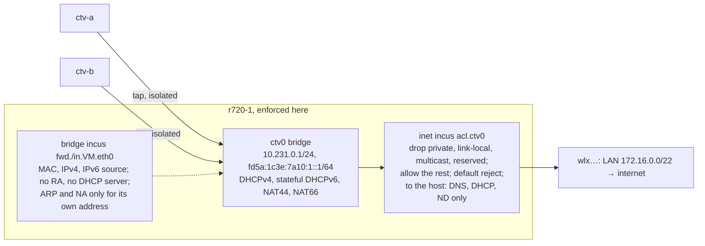

# Linux tenant VMs model

Runnable reference for [Kanna Cloud §3 and §8](../../../docs/specs/kanna-cloud.md#3-provisioning), the
Linux tenant VMs risk in the [build order](../../../docs/specs/machines-build-order.md#kanna-cloud). It
must pass before Cloud takes a second tenant (C3), and **Cloud 9: Provisioning** copies what it found.

Three parts:

| Part | Where | Shows |
|---|---|---|
| Network | [host/setup.sh](host/setup.sh), [host/check_net.py](host/check_net.py), [guest/probe.py](guest/probe.py) | two users' VMs on r720-1 reach the internet and the iroh relay, and nothing else: not each other, the host, the iDRAC, the LAN or the host's other VMs, over IPv4 and IPv6, even when root in a VM forges ARP, ND, RA, DHCP, addresses and MACs |
| Release | [host/check_release.py](host/check_release.py) | what `incus delete` leaves behind, that a same-named VM inherits some of it, and a release that leaves nothing |
| `hosted` key | [hosted/](hosted/) | the peer-log rule ([§9](../../../docs/specs/kanna-cloud.md#9-open-questions), proposed): an add signed by a `hosted` key never counts, and it may revoke only itself |

This is a throwaway model. It isn't hardened, and its scripts shell out freely: security findings in the model are handled in the product, not fixed here.

## Run

The network and release checks run on r720-1 as root and touch only their own objects: VMs named `ctv-*`, the bridge `ctv0`, the ACL and profile `ctv-tenant`, and the LVM pool `ctv` (a 60 GiB loop-backed thin pool). They leave the host's existing VMs, their `auth-probe0` bridge and its Wi-Fi uplink alone.

```sh
rsync -a --exclude .venv references/prototypes/cloud-tenant-vms/ jeremyhale@172.16.0.105:ctv/
ssh jeremyhale@172.16.0.105
sudo ~/ctv/host/setup.sh ctv-a ctv-b
sudo python3 -I ~/ctv/host/check_net.py ctv-a ctv-b
sudo python3 -I ~/ctv/host/check_release.py ctv-a
sudo ~/ctv/host/teardown.sh
```

`setup.sh` first arms a timed rollback, `systemd-run --on-active=90min teardown.sh` (`ROLLBACK_MIN` changes it), so the host returns to how it was even if the session is lost. `teardown.sh` removes every `ctv` object and unloads `br_netfilter` if setup loaded it. The release check takes about 20 minutes: it makes four VMs and fills and scans their disks. Write logs outside `~/ctv`: the next `rsync --delete` removes them.

The `hosted` simulation runs anywhere with Python 3.9 or newer:

```sh
cd references/prototypes/cloud-tenant-vms/hosted
python3 -m venv .venv && .venv/bin/python -m pip install -r requirements.txt
.venv/bin/python demo.py
.venv/bin/python -m unittest -v
```

## The host as found

The task assumed r720-1's VMs were bridged onto the LAN. They aren't: the host has no Ethernet yet (its uplink is a USB Wi-Fi dongle, `wlxe0d768301a7a`, which can't be bridged), and its three VMs (`agent-sign-in-a`, `agent-sign-in-b`, `xcodebuild-shim`) sit behind NAT on Incus's `auth-probe0` (10.199.64.0/24) with an accept-all forward chain, so nothing stops them reaching the LAN (another task added `s1-vm` on `s1-br0` during this run). The LAN is 172.16.0.0/22, not /24, and has no IPv6 beyond link-local; the iDRAC is 172.16.0.2 on its own port; the Incus API listens only on its unix socket (`core.https_address` unset). Checks use the /22.

## Design



One shared bridge for all tenants, with four layers, all set up by Incus and enforced on the host:

| Layer | Setting | Stops |
|---|---|---|
| Port isolation | NIC `security.port_isolation=true` | any frame between two tenants' ports, broadcast and multicast included |
| Source filtering | NIC `security.mac_filtering`, `ipv4_filtering`, `ipv6_filtering` | a guest sending as another MAC or address, ARP or NA for an address not its own, RAs, DHCP offers |
| ACL | network `security.acls=ctv-tenant`, default egress `reject`, ingress `drop` | traffic to the host's addresses and services, the LAN, the iDRAC, other bridges, metadata; anything inbound not a reply |
| NAT | `ipv4.nat`, `ipv6.nat` | tenant addresses leaving the host |

`dns.mode=none` keeps tenant names out of the bridge's DNS. Rules in the ACL: egress `drop` to 0.0.0.0/8, 10/8, 100.64/10, 127/8, 169.254/16, 172.16/12, 192.0.0/24, 192.168/16, 198.18/15, 224/4, 240/4, and ::/128, ::1, 64:ff9b::/96, 100::/64, fc00::/7, fe80::/10, fec0::/10, ff00::/8; then egress `allow`.

## What it showed

Run on 2026-10-26, r720-1 (Ubuntu 26.04, kernel 7.0.0-30, Incus 6.0.5, nftables 1.1.6), guests Ubuntu 26.04 cloud images.

### Network: 28 of 28 passed

[results/net.txt](results/net.txt) has the full output. Both directions (ctv-a to ctv-b and back) were probed, the attacks from ctv-a as root:

| Check | Result |
|---|---|
| Both VMs have their IPv4, ULA, link-local and the gateway's MAC | yes |
| Internet over IPv4 | HTTPS to example.com 200, ping 1.1.1.1 |
| DNS through the gateway | resolves |
| iroh relay | `https://relay.kanna.build:8443/ping` 200 |
| IPv6 on the bridge | the gateway's DNS on `[fd5a:1c3e:7a10:1::1]:53` answers |
| The other VM | TCP 8000 (a listener runs there) and ping, to its IPv4, ULA and link-local: all dropped |
| The host | `:22` and `:8443` on the gateway's IPv4, ULA and link-local, and on 172.16.0.105: all dropped. Only DNS (53), DHCP (67, 547) and ND reach the host |
| The LAN, iDRAC, other VMs, metadata | 172.16.0.2 `:22`/`:443`, the router 172.16.0.1, `auth-probe0`'s 10.199.64.1, 169.254.169.254: all dropped |
| `ff02::1` | only the gateway answers |
| 45 forged frames from ctv-a (3 × 15: ARP replies and requests claiming the gateway's or ctv-b's address, unsolicited NAs for the gateway and ctv-b, an RA for 2001:db8:bad::/64, a DHCP offer, frames to ctv-b's MAC direct, VLAN-tagged, with ctv-b's MAC as source, via the gateway's MAC, spoofed IPv4 and IPv6 sources) | ctv-b's sniffer saw **0**; the host's ARP and ND entries for ctv-b, and ctv-b's for the gateway, kept the right MACs; ctv-b took no rogue prefix or route |
| ctv-a as root changes its MAC (random, then ctv-b's), adds another IPv4 address, ctv-b's, the gateway's, another ULA, another link-local, and uses each | nothing gets through; restored, it's back online |
| **Control:** port isolation turned off on ctv-a's tap for 12 s | ctv-b sees 4 of its ARP requests at once, so the sniffer would catch a leak; isolation back on |
| Enforced on the host | the rules are in `table bridge incus` (`fwd.ctv-a.eth0`, …) and `table inet incus` (`acl.ctv0`), the taps `isolated on`; nothing in the guest takes part |

Not shown: **internet over IPv6.** r720-1 has no IPv6 uplink (the LAN has none), so a guest's IPv6 reaches the gateway and stops (`ENETUNREACH`). Isolation over IPv6 was shown; IPv6 egress wasn't.

### Release

**8 of 8 passed**, with what `incus delete` leaves recorded first; [results/release.txt](results/release.txt) has the output.

The tenant VM `ctv-a` fills 512 MiB of its root disk and of a 2 GiB block volume (`ctv-a-data`, attached) with a random marker (18.5 million hits on each), writes it to its serial console, makes a flow to example.com, and is snapshotted (`s1`).

**`incus delete --force` alone** removes the instance, its root LVs and snapshot, its config dirs, its DHCPv4 lease and its bridge filter chains. It leaves:

| Left | Why it matters |
|---|---|
| the custom volume `ctv-a-data` (its LV, full of the marker) | Incus never deletes custom volumes with an instance; a provisioner that attaches a volume by name gives it to the next user: the same-named VM made next **saw all 18.5 million marker hits on its data disk** |
| `/var/log/incus/ctv-a/console.log`, with the marker | the tenant's console output (boot logs, anything printed on `ttyS0`) stays on the host. A new VM of the same name starts a fresh log, so it didn't inherit it |
| `/run/incus/ctv-a/qemu.conf` | the old VM's QEMU config |
| the host's neighbour entries for its IPv4 and ULA | stale until they age out |
| conntrack entries: DNS, NTP and the HTTPS flow in `TIME_WAIT` | the next VM gets the same address (10.231.0.2), so a late reply to an old flow would be NATed to it |
| sometimes the DHCPv6 lease | it drops out on its own a moment later |

**The release** ([`release()`](host/check_release.py)) then does `incus delete --force`; deletes the VM's custom volumes; removes `/var/log/incus/VM` and `/run/incus/VM`; deletes conntrack entries and neighbour entries for each of its addresses; sends dnsmasq a DHCPv6 RELEASE (`dhcp_release6`) for any lease left; and waits 3 s. Editing dnsmasq's lease file instead, as tried first, broke the next VM: dnsmasq kept the old lease in memory (`not using configured address 10.231.0.2 because it is leased to …`), gave the new VM 10.231.0.233, and the IPv4 filter, which allows only the address Incus assigned, cut it off.

| Check | Result |
|---|---|
| After the release | no LVs, volumes, snapshots, dirs, logs with the marker, DHCP hosts or leases, nft chains, neighbours or conntrack entries |
| A new VM of the **same name** with a new data volume of the same name | online from the address Incus gave it (HTTPS 200), a new MAC, no snapshots, **0 marker hits** on its root and data disks, no old console or QEMU log |

The pool is LVM thin (`IncusThinPool`, `zero` on): new thin blocks read as zeroes, so even the same-named VM's root disk, after a bare `incus delete`, had 0 hits.

### `hosted` key: 11 tests and the demo passed

[hosted/model.py](hosted/model.py) is the [fleet-pairing](../fleet-pairing/README.md) peer log cut to adds and revocations, with one change: an add's payload carries `hosted`, set by the device that enrolls a Cloud VM, and:

- **An add signed by a `hosted` key never counts:** refused on merge (`hosted_signer`), and ignored by the view if an older peer stored it anyway, so the stranger it names is `unpaired`, and a key that stranger signs for counts for nothing either.
- **A `hosted` key revokes only itself.** A revocation of anyone else is refused on merge and ignored in the view: the user's Mac and Linux box stay trusted. Its own revocation counts everywhere.
- **`hosted` sticks to a key:** the VM can't re-add itself unhosted (`hosted_signer`), a user device can't either (`hosted_downgrade`), under the same name or a new one; once any add in the log marks a key `hosted`, it is.
- **User devices are unchanged:** they add and revoke as before, a hosted VM included, and a revoked device stays revoked whatever a hosted key signs.
- **Order doesn't matter:** every one of the 120 orders of two valid entries (a user's add, the VM's self-revocation) and three forged ones (the VM adding a stranger, revoking the Mac, revoking the box) ends with the same trusted set: the Mac, the box and the new laptop.

Removing the rule from the model makes 7 of the 11 tests fail.

```text
PASS hosted_adds_stranger: hosted_signer
PASS hosted_revokes_mbp: hosted_signer
PASS hosted_readds_self_unhosted: hosted_signer
PASS user_downgrades_hosted: hosted_downgrade
PASS stored_forgeries_ignored: unpaired
PASS mbp_still_trusted: counted
PASS hosted_revokes_self: counted
PASS hosted_now_refused: revoked
```

## Found along the way

- **`br_netfilter` is needed:** Incus refuses `security.ipv6_filtering` without it. Loading it makes bridged frames on every bridge, `auth-probe0` included, pass the host's inet hooks; its chains accept, so nothing changed for those VMs. The product loads it at boot.
- **IPv6 filtering needs an address Incus knows.** With SLAAC alone (`ipv6.dhcp=false`), Incus filters out all of a guest's IPv6 (`ether type ip6 drop`). With `ipv6.dhcp.stateful=true` it pins one address per NIC and allows only that. It then also drops the guest's link-local source, so the host learns a guest's MAC only from the guest's own neighbour solicitations; that was enough here.
- **Incus misfiles `::ffff:0:0/96` as IPv4** in an ACL (`nft` fails: `Prefix length 96 is invalid`). It was left out; IPv4-mapped addresses aren't routed anyway.
- **The host gained two packages,** `conntrack` and `dnsmasq-utils`, for the release; they stay.
- **A failed `incus network create` leaked its dnsmasq,** which held the address and failed the next create with `Address already in use`. It had to be killed by PID.
- **The `incus` client reads stdin when it isn't a terminal.** `incus init` and `incus storage volume create` under `ssh` or `subprocess` hung waiting for YAML until stdin was `/dev/null`.

## What Cloud 9 must do

1. **A tenant bridge of its own on every host,** never the bridge the operator's VMs or the LAN use, with one config: `ipv4.nat=true`, `ipv6.dhcp.stateful=true`, `dns.mode=none`, `security.acls` set to the tenant ACL above, default egress `reject` and ingress `drop`. It's [host/setup.sh](host/setup.sh)'s `incus network create`.
2. **Every tenant NIC** with `security.port_isolation`, `mac_filtering`, `ipv4_filtering` and `ipv6_filtering` on, from a profile the tenant can't change; `br_netfilter` loaded at boot.
3. **[check_net.py](host/check_net.py) as a host acceptance test:** run against two throwaway VMs on every new host, after every Incus or kernel upgrade, and before a host takes tenants. Re-run it once a host has an IPv6 uplink, since internet over IPv6 is the one thing this model couldn't show. With a routed prefix, give tenants global addresses rather than NAT66, and keep the same ACL.
4. **A release that is more than `incus delete`:** delete the instance (its snapshots go with it); delete every custom volume the VM owned, which Incus keeps; remove `/var/log/incus/VM` (its console log holds the tenant's output) and `/run/incus/VM`; flush the VM's addresses from conntrack and the bridge's neighbour table; release a DHCPv6 lease still there with a DHCPv6 RELEASE to dnsmasq. Never edit dnsmasq's lease file: it keeps leases in memory, and the next VM gets an address the filter blocks. Check the new VM is online from the address Incus gave it.
5. **Never reuse a name:** a VM and its volumes are named by a fresh ID per allocation, not per user. A same-named VM given its volume by name got the last tenant's data disk, marker and all.
6. **Thin pools that zero new blocks** (LVM thin's default, `zero`, as here): a new VM's disks never show a released VM's blocks. Keep it on, and check it on any other storage driver before using it.
7. **The `hosted` mark in the peer log,** as [hosted/model.py](hosted/model.py): `hosted` in the add's payload, set by the enrolling device; refuse an add signed by a hosted key (`hosted_signer`) and a revocation by one of anyone but itself; refuse dropping the mark (`hosted_downgrade`); and ignore such entries in the view even if a peer stored them. Every peer must run the rule before the first hosted VM enrolls, since an older peer would count a hosted key's adds: it ships as a change to [identity §3](../../../docs/specs/machine-identity.md#3-the-peer-log), and the app adds a hosted VM only once every trusted peer it can reach reports a protocol version with the rule.
8. **Run `incus` with stdin from `/dev/null`** in the provisioner, and after a failed `incus network create` check for a leftover dnsmasq.
