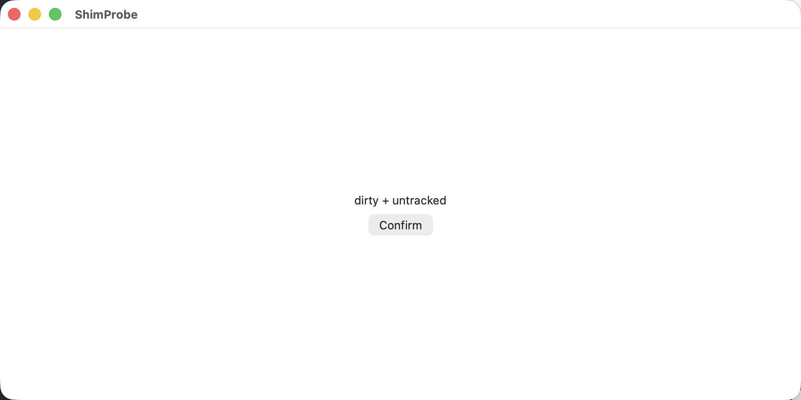

# xcodebuild shim model

Reference for [Fleet §10](../../../docs/specs/fleet.md#10-build-order), before
slices 7 and 12; follows [build Macs](../../../docs/specs/build-macs.md) and
the [research](../../../docs/research/xcodebuild-shim.md).

**Status: forwarding proof complete; shared build-Mac isolation is not proved.**
The user authorized an owner-account UI experiment, then required proper isolation
for multiple users on one Mac. The [isolation spec](../../../docs/specs/build-mac-isolation.md)
now mandates tenant-exclusive macOS VMs for remote builds. This model's host
executor is an experiment only; Fleet 7 and 12 also wait for the separate
`build-mac-isolation` model. Host accounts do not satisfy that requirement.
This is a Python experiment, not product code. It builds a tiny macOS SwiftUI
app, not Kanna.app (building Kanna.app is slice 7's acceptance requirement).

## Observed on 24–25 October 2026

Real runs on the r720-1 Incus VM → this Mac, Xcode 26.6:

| Check | Observed |
|---|---|
| Fresh dirty build | Passed; 7.47 s, 4 Swift compile log entries |
| Warm rebuild of the same snapshot | Passed; 1.75 s, no Swift compile entries |
| Dirty/untracked/deleted inputs, executable, symlink, unpushed commit | Fixture build script and compiled app passed |
| Deliberate Swift compiler failure | Exit 65; mapped `/worktrees/fixture/App/App.swift:14:30` |
| Swift unit test | 1 passed; `.xcresult` and JSON retrieved |
| Subdirectory cwd and explicit result path | Passed from `App/`; result bundle returned to the requested Linux path |
| Requested app | Archived on Mac and retrieved with verified SHA-256 |
| Closed SSH connection | Same job retrieved; exit 7 and exact literal argv preserved |
| Edit after submission | Mac saw captured bytes; Linux's later edit remained intact |
| Cancellation | Process group terminated; build exit −15, CLI exit 143 |
| Two tasks submitted together | Separate mirrors; both completed under one heavy slot |
| Owner console UI test | 1 passed as `jeremyhale`, UID 502 = console UID, Aqua; screenshot returned to Linux |
| Shared build-Mac isolation | Not exercised; requires tenant-exclusive macOS VM model before Fleet 7 and 12 |

Recorded reports: [builds](evidence/builds.json), [lifecycle](evidence/lifecycle.json),
[machine/session identity and raw diagnostic](evidence/run.json),
[relative path options](evidence/path-options.json), [console UI test](evidence/ui.json).
Timings cover worker preparation, build and artifact staging on this small fixture;
they are not a Kanna.app performance prediction. Full logs and results remain in
the rig's private scratch directories and on the VM.
The owner LaunchAgent and dedicated VM were stopped after these checks; their
scratch state remains for reproduction. Run `sudo incus start xcodebuild-shim`
on r720-1 and restart the endpoint to resume.

Returned test-window screenshot:



## What runs

`xcodebuild` on the Linux PATH invokes `model.py run`. The client copies current
files into staging and sends an archive plus a Git bundle to the Mac. A loopback
HTTP endpoint carried through an SSH reverse tunnel stands in for the future
daemon `sync` stream. No Mac SSH credentials are given to Linux.

The Mac starts a detached worker per request ID. Its lock covers overlaying the
snapshot onto a Mac-local Git checkout, executing argv directly, and staging
artifacts. A single heavy slot bounds work across mirrors. Mirror identity is
(Linux hostname, hash of Git common-directory path, task ID), not branch or
basename. DerivedData persists outside source and is keyed by Xcode version.

Requests pin `DEVELOPER_DIR`, preserve the relative cwd, and map recognized path
arguments. Raw stdout/stderr return without rewriting. `diagnostics.txt` maps
source diagnostics to the original Linux root; generated/dependency diagnostics
are outside this model's mapping contract. The Mac exports `.xcresult` summaries
and attachments, and archives a requested app. The client verifies artifact
checksums. Explicit result-bundle/archive paths are copied to their Linux paths;
caches stay on the Mac. Source never syncs back.

`launch_agent.py` starts the endpoint in the logged-in user's Aqua domain.
`--ui` refuses execution unless the worker's UID owns `/dev/console` and its
launchd manager is Aqua. The UI proof asserts an expected user: `kanna-build`
by default, or an explicitly named owner for the MBP case. The evidence records
which account actually ran the test.

## Run

Dependencies: Python 3 (stdlib only), Git and rsync; Xcode on the Mac. Generating
the fixture needs XcodeGen (tested with 2.45.3). There is no Apple account or
distribution-signing dependency: the macOS fixture uses ad-hoc signing.

1. On the Mac, choose a private scratch directory, generate a token there, and
   start the endpoint as the current console user. This installs a transient
   LaunchAgent in the current session, not a root daemon:

   ```sh
   MODEL="$PWD/references/prototypes/xcodebuild-shim"
   RIG=/private/tmp/kanna-shim-model
   mkdir -p "$RIG"
   python3 -c 'import pathlib,secrets,sys; p=pathlib.Path(sys.argv[1]); p.write_text(secrets.token_hex(32)); p.chmod(0o600)' "$RIG/token"
   python3 "$MODEL/launch_agent.py" "$RIG/state" --token-file "$RIG/token" --port 48763
   python3 "$MODEL/make_fixture.py" "$RIG/fixture"
   python3 -m unittest discover -s "$MODEL" -p 'test_*.py' -v
   ```

2. Use a disposable Ubuntu VM with Git, Python and openssh-server. On this rig:
   Incus `xcodebuild-shim` on `jeremyhale@172.16.0.105`, 2 CPUs, 4 GiB RAM,
   20 GiB disk, using the existing `auth-probe` pool and `auth-probe0` bridge.
   Its initial IP is `10.199.64.34`; inspect `sudo incus list` before reusing it.
   The VM was created from cached Ubuntu 26.04 image `d939da6b6d26`.

   Transfer the fixture **including its .git**, then chown it to the VM user.
   Put it at `/worktrees/fixture`. Put `model.py`, `prove.py`, and executable
   `xcodebuild` in `/opt/kanna/current/shim`. Transfer the token to `/root/token`
   with mode 600. Use a disposable SSH key authorized only in this VM; keep its
   private half on the Mac, outside the repo. Neither agent nor Git credentials
   are needed in the VM. When archiving on macOS, use Python `tarfile` or disable
   AppleDouble metadata; `._*` files are not fixture inputs.

3. From the Mac, open a connection that carries the reverse tunnel. The tunnel
   only listens on the VM's loopback. Substitute your private key and known-hosts
   file paths (the live rig keeps both in `$RIG`):

   ```sh
   ssh -J jeremyhale@172.16.0.105 -i "$RIG/vm-key" \
     -o UserKnownHostsFile="$RIG/known_hosts" -o ExitOnForwardFailure=yes \
     -R 48763:127.0.0.1:48763 root@10.199.64.34
   ```

4. In that Linux shell:

   ```sh
   cd /worktrees/fixture
   export PATH=/opt/kanna/current/shim:$PATH
   export SHIM_URL=http://127.0.0.1:48763 SHIM_TOKEN_FILE=/root/token
   xcodebuild -project "$PWD/ShimProbe.xcodeproj" -scheme ShimProbe -destination platform=macOS build
   python3 /opt/kanna/current/shim/prove.py builds
   python3 /opt/kanna/current/shim/prove.py disconnect
   exit
   ```

   End the SSH connection completely, reconnect with the same tunnel, re-export
   the environment, and run `prove.py reconnect`. This retrieves the original job,
   checks its captured source and exact argument boundaries, then tests cancellation
   and two tasks. `prove.py builds` creates a fresh mirror for its cold/warm pair.
   Assertions check the real Xcode result, including a deliberate compiler error
   with exit 65. Evidence goes under `.kanna/proof/` on Linux; ordinary shim runs
   write `.kanna/build/<job>/` and save the last ID in `.shim-last-job.json`.

5. With the endpoint running as the Mac's current console user, run the UI
   proof from Linux, naming the expected **Mac** user (not Linux's `root`):

   ```sh
   python3 /opt/kanna/current/shim/prove.py ui jeremyhale
   ```

   The isolation follow-up must run this fixture inside tenant-exclusive macOS
   guests, with `kanna-build` logged in inside each guest, and run `prove.py ui`
   without the owner override. Creating another host account is not sufficient.
   Do not substitute `sudo -u` or a background SSH session for a guest console
   login. This README does not provision or claim to isolate those guests.

   The test launches the fixture app, asserts its dirty/untracked label, clicks
   its button and attaches a window screenshot. It verifies the expected user, the matching
   console UID, Aqua, one passing UI test, and a returned PNG. A macOS automation
   permission prompt requires the user; stop there if one appears. No user
   account, login, TCC grant, or password is created by these scripts.

Individual calls also support `model.py run --detach -- COMMAND ...`,
`model.py attach JOB OUTPUT_DIRECTORY`, and `model.py cancel JOB`. To run an entire
script, pass `-- ./script.sh`; shell fragments are not implicitly interpreted.
`--root`, `--cwd`, `--task`, `--app ShimProbe.app`, and `--developer-dir` select
the relevant request fields. Use `--ui` (or `SHIM_UI=1` with the PATH wrapper)
for GUI work. `status.json` keeps `build_exit` and artifact state separate;
transport/model errors use CLI status 125 and do not invent a build result.

## What the slice should copy

- Capture before submission, including dirty/untracked/deleted files, symlinks,
  executable modes and an unpushed Git bundle; never read live source later.
- Hold the mirror lock through sync, execution and artifact staging. Use stable
  source and cache paths, and a distinct directory per job's results.
- Pass structured argv directly; retain raw output and a separate mapped view.
  Account for Mac path aliases when constructing diagnostic mappings.
- Persist IDs, logs, status and artifacts outside the client connection. Retrying
  a request or reconnecting must not execute it a second time.
- Require the UI job's **own guest** Aqua console session; record tenant, VM, UID
  and session identity in the isolation follow-up. This experiment uses the host
  owner and does not exercise that boundary.

## Boundaries and surprises

- Xcode used `/tmp/...` for a mirror addressed as `/private/tmp/...`. An exact
  prefix mapper missed real diagnostics until both spellings were registered.
- The repo's linked-worktree `.git` cannot travel verbatim. The fixture has an
  unpushed commit and verifies Git works inside the reconstructed Mac checkout.
- A default local port was already occupied; the rig uses explicit port 48763.
- macOS tar can add AppleDouble files, and its numeric file owner makes Linux
  Git reject a transferred checkout as dubious. Use a metadata-neutral archive
  and assign ownership on import.
- `XCUIApplication.screenshot()` included the desktop in this macOS test.
  Capture `app.windows.firstMatch.screenshot()` for an artifact of just the app.
- This transports full gzip snapshots, with local rsync overlay. It does **not**
  measure or model block-delta transport. The product must use the spec's daemon
  stream, not this SSH/HTTP adapter.
- Stop concurrent writers during snapshot capture. Copying a directory is not
  an atomic filesystem snapshot; this model does not coordinate other writers.
- The service trusts uploaded archives, paths and commands. This is not a
  security boundary; archive/input hardening belongs in the product. Keep it
  loopback-only behind the SSH tunnel. Tokens and SSH keys stay outside Git.
- No root job launcher, device-key isolation, reboot recovery, crash reconciliation,
  fair scheduling, separate UI slot, simulator leasing, pool selection, quotas,
  LFS/submodule handling, external uploads, or arbitrary `xcrun`/Swift forwarding
  is claimed. The prototype covers macOS XCUITest, not an iOS Simulator lease.
- Product acceptance still needs failed-test attachment export and explicit
  `simctl` screenshot return, Kanna.app, broader path options, and all pool cases.
  This model exports XCUITest attachments and demonstrated its window screenshot
  reaching Linux; it does not implement arbitrary `simctl` screenshot forwarding.

Cleanup after the evidence is complete: `launchctl bootout
gui/$(id -u)/dev.kanna.shim-model` as the relevant Mac user; close the SSH tunnel;
`sudo incus delete --force xcodebuild-shim` on r720-1; remove only the scratch
directories and disposable keys created for this rig. Removing the job account
is a separate user-approved system change. Never delete the shared Incus pool or
the other tasks' VMs.
